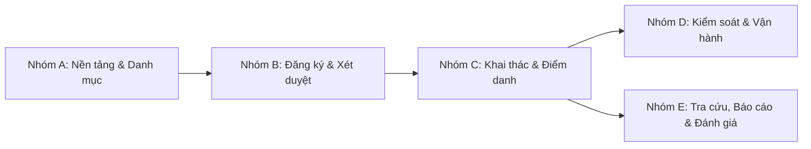

# HUIT-RoMan — Hệ thống Quản lý Đăng ký và Khai thác Phòng dùng chung

> **Đơn vị chủ quản:** Trường Đại học Công Thương TP. Hồ Chí Minh (HUIT)  
> **Mã đề tài:** Khóa luận Tốt nghiệp CNTT-KLCN236  
> **Nền tảng hỗ trợ:** Web Portal (Quản trị & Người dùng) + Mobile App (Flutter dành cho Sinh viên & Giảng viên)  
> **Trạng thái:** Hoàn thiện tích hợp đầy đủ Backend API, Web Portal và Mobile App.

---

## 📌 Mục lục

- [1. Giới thiệu tổng quan](#1-giới-thiệu-tổng-quan)
- [2. Mục tiêu & Bài toán giải quyết](#2-mục-tiêu--bài-toán-giải-quyết)
- [3. Đối tượng & Phân quyền người dùng](#3-đối-tượng--phân-quyền-người-dùng)
- [4. Các phân hệ nghiệp vụ chính](#4-các-phân-hệ-nghiệp-vụ-chính)
- [5. Kiến trúc hệ thống & Công nghệ](#5-kiến-trúc-hệ-thống--công-nghệ)
- [6. Cấu trúc cây thư mục dự án](#6-cấu-trúc-cây-thư-mục-dự-án)
- [7. Hướng dẫn cài đặt & Khởi chạy](#7-hướng-dẫn-cài-đặt--khởi-chạy)
- [8. Danh sách tài khoản thử nghiệm (Demo)](#8-danh-sách-tài-khoản-thử-nghiệm-demo)
- [9. Quy chuẩn kiểm thử & Đóng góp](#9-quy-chuẩn-kiểm-thử--đóng-góp)

---

## 1. Giới thiệu tổng quan

**HUIT-RoMan** (*Room Management*) là giải pháp số hóa toàn diện quy trình đăng ký, xét duyệt, điều phối và khai thác hệ thống phòng học, phòng chức năng và trang thiết bị dùng chung tại **Trường Đại học Công Thương TP.HCM (HUIT)**.

Hệ thống thay thế phương thức quản lý thủ công (ghi sổ truyền thống, xác nhận giấy tờ rời rạc) bằng một luồng nghiệp vụ khép kín thời gian thực: từ tra cứu phòng trống theo khung tiết học HUIT $\rightarrow$ gửi đơn đăng ký $\rightarrow$ xét duyệt phân cấp $\rightarrow$ nhận phòng bằng mã định danh/OTP $\rightarrow$ kiểm soát sử dụng & tự động hủy vắng mặt (No-Show) $\rightarrow$ trả phòng kiểm kê hiện trạng $\rightarrow$ xử lý vi phạm & thống kê khai thác.

---

## 2. Mục tiêu & Bài toán giải quyết

Hệ thống được thiết kế bám sát vào đặc thù vận hành của HUIT:

1. **Chuẩn hóa theo 2 bộ 16 tiết học HUIT:**
   - **Bộ 16 tiết Lý thuyết (Tòa A, B):** Bắt đầu từ `06:30` đến `21:30`.
   - **Bộ 16 tiết Thực hành máy tính (A101–A111):** Bắt đầu từ `07:00` đến `21:20`.
   - Ngăn chặn tình trạng chọn chéo tiết giữa các khối phòng.
2. **Quy mô 105 phòng học & không gian chuyên đề:**
   - 11 phòng thực hành máy tính (A101–A111, sức chứa 40 máy).
   - 88 phòng giảng đường lý thuyết (A201–A511 & B201–B511, sức chứa 60 chỗ).
   - 6 phòng chuyên đề Thư viện (4 phòng học nhóm, 1 phòng thuyết trình, 1 phòng hội thảo).
3. **Chống trùng lịch đa tầng:**
   - Kiểm tra giao thoa thời gian ở tầng nghiệp vụ (`Application Service`).
   - Ràng buộc loại trừ thời gian không gian ở tầng cơ sở dữ liệu (`PostgreSQL EXCLUDE USING gist (room_id WITH =, tstzrange(start_at, end_at) WITH &&)`).
4. **Kiểm soát sử dụng thực tế & Tự động hủy vắng mặt (No-Show):**
   - Mở cửa sổ điểm danh nhận phòng trong khoảng `[T - 15 phút, T)` (với `T` là giờ bắt đầu).
   - Background Worker quét tự động mỗi 30 giây: nếu quá giờ `T` mà người đặt chưa nhận phòng, hệ thống tự động hủy đơn với lý do `NO_SHOW`, giải phóng phòng lập tức cho người khác và ghi nhận lịch sử.
5. **Duyệt đơn linh hoạt theo từng phòng (Partial Approval):**
   - Một đơn đặt nhiều phòng có thể duyệt một phần (chấp nhận phòng khả dụng, từ chối kèm lý do với phòng không hợp lệ).

---

## 3. Đối tượng & Phân quyền người dùng

Không có tính năng đăng ký tự do; toàn bộ tài khoản được cấp phát theo định danh email nhà trường (`@huit.edu.vn`).

| Nhóm hiển thị | Vai trò hệ thống (Role) | Đối tượng | Quyền hạn chính |
|---|---|---|---|
| **Người dùng** | `Student` (Sinh viên) | Sinh viên chính quy (đăng nhập MSSV) | - Đặt phòng học nhóm / thuyết trình tại Thư viện (khung 07:00–20:00, tối đa 2h/lượt, trước 14 ngày).<br>- Nhận phòng bằng mã/OTP, trả phòng checklist thiết bị, gửi phản hồi.<br>- Xem lịch phòng cá nhân, nhận thông báo, chat hỗ trợ. |
| **Người dùng** | `Lecturer` (Giảng viên) | Giảng viên trường (đăng nhập MSGV) | - Đặt mọi loại phòng: Lý thuyết, Thực hành máy tính, Thư viện, Hội trường theo lịch giảng dạy.<br>- Đầy đủ quyền nhận/trả phòng, quản lý lịch sử đơn. |
| **Nhân sự** | `Employee` (Nhân viên / Thủ thư) | Cán bộ Quản lý phòng, Thủ thư | - Xét duyệt/từ chối đơn đặt phòng thuộc đơn vị quản lý.<br>- Check-in hộ (Staff Override) khi sinh viên gặp sự cố thiết bị.<br>- Lập biên bản vi phạm, nhắc nhở quy chế, xử lý thiết bị hỏng.<br>- Quản lý ca trực, ghi nhật ký bàn giao ca, hỗ trợ live chat. |
| **Quản lý đơn vị** | `Employee` (Trưởng đơn vị / Manager) | Lãnh đạo Thư viện, Phòng Đào tạo | - Phân công ca trực cho nhân sự trong đơn vị.<br>- Giám sát phê duyệt đơn, thống kê khai thác phòng của đơn vị. |
| **Quản trị viên** | `Admin` | Quản trị viên hệ thống | - Toàn quyền quản trị tài khoản, danh mục phòng, loại phòng, thiết bị, khung giờ.<br>- Xem bảng điều khiển KPIs, xuất báo cáo thống kê CSV UTF-8 BOM.<br>- Ban hành / gỡ lệnh cấm mượn phòng (`UserRestriction`). |

---

## 4. Các phân hệ nghiệp vụ chính

Hệ thống được thiết kế theo 5 nhóm nghiệp vụ với 15 nghiệp vụ chuẩn HUIT:



### 1. Phân hệ Nền tảng & Quản lý Danh mục (Nhóm A)
- **Xác thực JWT:** Cấp token 7 ngày, kiểm tra tài khoản khóa (`LockoutEnd`), quên mật khẩu qua OTP email.
- **Quản lý 105 phòng & Bộ tiết:** Phân cấp Cơ sở $\rightarrow$ Tòa nhà $\rightarrow$ Tầng $\rightarrow$ Loại phòng $\rightarrow$ Sức chứa. Quản lý trạng thái: *Available*, *InUse*, *Maintenance*, *Reserved*.
- **Quản lý Trang thiết bị:** Theo dõi máy chiếu, điều hòa, máy tính, bảng tương tác. Tự động chuyển phòng sang "Bảo trì" khi thiết bị trọng yếu gặp sự cố.

### 2. Phân hệ Đăng ký & Xét duyệt đơn (Nhóm B)
- **Tra cứu lịch phòng đa dạng:** Lịch Ngày / Tuần / Tháng, trực quan hóa trên trục thời gian.
- **Quy tắc tạo đơn chặt chẽ:** Kiểm tra ma trận quyền vai trò, số giờ tối đa, đặt trước tối đa 14 ngày, không đặt ngày quá khứ / Chủ Nhật (đối với sinh viên).
- **Hủy đơn trực tuyến:** Cho phép hủy trước giờ bắt đầu tối thiểu 3 giờ kèm lý do.
- **Phê duyệt đơn:** Duyệt toàn bộ, duyệt một phần, hoặc từ chối kèm lý do; lưu vết audit trail (`ApprovalHistories`). Hỗ trợ chế độ tự động duyệt khi được cấu hình.

### 3. Phân hệ Khai thác phòng & Điểm danh (Nhóm C)
- **Cửa sổ nhận phòng `[T - 15 phút, T)`:** Nhập mã sử dụng 6 ký tự hoặc mã OTP gửi qua Gmail sinh viên; hỗ trợ cán bộ check-in hộ.
- **Tự động hủy vắng mặt (`BookingNoShowWatcher`):** Background service quét mỗi 30 giây, hủy đơn chưa nhận phòng sau giờ T, giải phóng phòng tức thời.
- **Bàn giao & Checklist hiện trạng khi trả phòng:** Kiểm tra 3 tiêu chí: *Thiết bị hoạt động tốt*, *Vệ sinh phòng ốc*, *Đã tắt điện/điều hòa*. Tự chuyển phòng sang bảo trì nếu phát hiện hỏng hóc.
- **Gia hạn phòng:** Cho phép gia hạn phiên đang dùng nếu không bị trùng đơn kế tiếp và chưa vượt khung giờ quy định.
- **Nhắc lịch tự động (`BookingReminderWatcher`):** Bắn thông báo trước giờ nhận phòng 30 phút và trước giờ kết thúc 15 phút.

### 4. Phân hệ Kiểm soát & Vận hành (Nhóm D)
- **Cơ chế nhắc nhở 3 cấp độ (Rule of 3 Warnings):**
  - Nhắc nhở lần 1 $\rightarrow$ Cảnh cáo lần 2 $\rightarrow$ Cảnh báo tối đa lần 3.
  - Tái phạm lần 4: Hệ thống tự động lập Biên bản vi phạm kỷ luật và áp lệnh cấm mượn phòng.
- **Chế tài vi phạm 3 mức độ:** Nhẹ (cảnh cáo, 0 ngày cấm), Vừa (cấm 3–14 ngày), Nghiêm trọng (cấm 30 ngày – 1 năm, bồi thường thiệt hại).
- **Ca trực & Nhật ký bàn giao ca:** 3 ca trực HUIT (Sáng, Chiều, Tối), ghi nhận số lượt phục vụ và sự cố trong ca.
- **Live Chat hỗ trợ trực tuyến:** Kết nối SignalR realtime giữa sinh viên/giảng viên và cán bộ trực ca.

### 5. Phân hệ Tra cứu, Báo cáo & Đánh giá (Nhóm E)
- **Tìm kiếm đa năng toàn hệ thống (`Ctrl + K`):** Tra cứu nhanh phòng học, mã đơn, người mượn, biên bản.
- **Báo cáo thống kê:** KPIs tổng thể, phân tích nguồn hủy đơn (Sinh viên hủy, Quá giờ tự hủy No-show, Cán bộ hủy), biểu đồ nhiệt tần suất mượn, thống kê vi phạm. Xuất dữ liệu CSV chuẩn UTF-8 có BOM mở trực tiếp trên Excel.
- **Đánh giá & Khảo sát:** Cho phép chấm 1–5 sao và gửi phản hồi chất lượng phòng học.

---

## 5. Kiến trúc hệ thống & Công nghệ

### 5.1. Mô hình kiến trúc
Hệ thống được thiết kế theo kiến trúc **Clean Architecture + Modular Monolith** phân tách rõ ràng trách nhiệm giữa các tầng:

```
[ Web Client (React 19) ]        [ Mobile Client (Flutter) ]
            \                                /
             \                              /
         HTTP RESTful API + SignalR WebSocket
                         │
                         ▼
        ┌──────────────────────────────────┐
        │       API Layer (Presentation)   │
        │  Controllers, Hubs, Background   │
        └─────────────────┬────────────────┘
                          │
                          ▼
        ┌──────────────────────────────────┐
        │    Application Layer (Business)  │
        │  Modules, Services, Interfaces   │
        └───────────┬──────────────┬───────┘
                    │              │
                    ▼              ▼
     ┌──────────────────────┐  ┌──────────────────────┐
     │ Domain Layer         │  │ Infrastructure Layer │
     │ Entities, Enums      │  │ EF Core, Repositories│
     └──────────────────────┘  │ PostgreSQL, Migrations│
                               └──────────────────────┘
```

### 5.2. Công nghệ sử dụng

| Phân tầng | Công nghệ / Thư viện chính |
|---|---|
| **Backend API** | • **.NET 8 (ASP.NET Core Web API)**<br>• **Entity Framework Core 8.0** (Code-First + Migrations)<br>• **PostgreSQL 16** với Npgsql & btree_gist extension<br>• **ASP.NET Core Identity** kết hợp **JWT Authentication**<br>• **SignalR** cho thông báo và chat realtime<br>• **BackgroundService** (`BookingNoShowWatcher`, `BookingReminderWatcher`)<br>• **Swagger / OpenAPI** tài liệu hóa API |
| **Frontend Web** | • **React 19** + **TypeScript** + **Vite 8**<br>• **React Router v7** định tuyến phân quyền (`/admin`, `/staff`, `/home`)<br>• **@microsoft/signalr** kết nối WebSocket thời gian thực<br>• **Axios** gọi API với bộ interceptor tự gắn JWT<br>• **Vitest** + **Testing Library** kiểm thử giao diện |
| **Mobile App** | • **Flutter 3.35+** (Dart 3.13+), hỗ trợ Android & iOS<br>• **Flutter Riverpod 3.4** quản lý trạng thái (State Management)<br>• **GoRouter 18** điều hướng khai báo phân quyền<br>• **Dio 5.11** kết nối mạng & tự động dò API URL<br>• **SignalR NetCore** kết nối kênh chat realtime<br>• **Flutter Secure Storage & SharedPreferences** lưu phiên đăng nhập<br>• **Flutter Local Notifications** thông báo cục bộ |
| **DevOps & Triển khai** | • **Docker** & **Docker Compose** đóng gói toàn bộ hệ thống (API, DB, Web)<br>• Bộ script Windows tự động hóa (`.bat`) |

---

## 6. Cấu trúc cây thư mục dự án

```text
HUIT-RoMan/
├── .github/workflows/          # Kịch bản CI/CD GitHub Actions
├── backend/                    # Mã nguồn Backend (.NET 8 Clean Architecture)
│   ├── HUIT-RoMan.sln          # Solution .NET
│   ├── account.md              # Danh sách tài khoản demo và mật khẩu
│   ├── api_documentation.md    # Tài liệu đặc tả endpoint RESTful API
│   ├── backend_setup.markdown  # Hướng dẫn chi tiết thiết lập Backend
│   ├── backend_structure.markdown # Chi tiết kiến trúc Modular Monolith
│   ├── Dockerfile              # Dockerfile đóng gói Backend API
│   ├── src/
│   │   ├── API/                # Layer 1: Presentation (Controllers, Hubs, Watchers, Program.cs)
│   │   │   ├── Controllers/    # 19 REST Controllers (Auth, Bookings, Rooms, Usage, ...)
│   │   │   ├── Hubs/           # SignalR Hubs (ChatHub)
│   │   │   └── Services/       # Background Watchers (NoShow, Reminders) & CurrentUserService
│   │   ├── Application/        # Layer 2: Business Logic (Services, DTOs, Mappings)
│   │   │   ├── Common/         # Interfaces (IRepository, IUnitOfWork, ApiResponse)
│   │   │   └── Modules/        # Modular Monolith theo từng nghiệp vụ:
│   │   │       ├── Booking/    # Nghiệp vụ đặt phòng, hủy đơn, kiểm tra trùng lịch
│   │   │       ├── Chat/       # Nghiệp vụ hỗ trợ trực tuyến
│   │   │       ├── Department/ # Nghiệp vụ đơn vị / khoa
│   │   │       ├── Feedback/   # Nghiệp vụ khảo sát & chấm điểm phòng
│   │   │       ├── Identity/   # Nghiệp vụ người dùng, phân quyền, xác thực
│   │   │       ├── Incidents/  # Nghiệp vụ báo cáo sự cố kỹ thuật
│   │   │       ├── Notification/# Nghiệp vụ thông báo hệ thống & gửi email
│   │   │       ├── Report/     # Nghiệp vụ báo cáo thống kê & xuất CSV
│   │   │       ├── Room/       # Nghiệp vụ phòng, loại phòng, thiết bị
│   │   │       ├── Shift/      # Nghiệp vụ ca trực & nhật ký giao ca
│   │   │       ├── Usage/      # Nghiệp vụ nhận/trả phòng, gia hạn, checklist
│   │   │       ├── Violation/  # Nghiệp vụ xử lý vi phạm, 3 cảnh cáo, cấm mượn
│   │   │       └── WorkingHours/# Nghiệp vụ khung giờ và bộ tiết học HUIT
│   │   ├── Domain/             # Layer 4: Thực thể nghiệp vụ thuần (Entities, Enums)
│   │   │   ├── Common/         # BaseEntity, AuditableEntity (Soft-delete)
│   │   │   ├── Entities/       # 35+ Entities (User, Room, Booking, UsageSession, ...)
│   │   │   └── Enums/          # BookingStatus, RoomStatus, SeverityLevel, ...
│   │   └── Infrastructure/     # Layer 3: Truy xuất dữ liệu (Data Access)
│   │       ├── Migrations/     # Các bản dịch chuyển cơ sở dữ liệu EF Core
│   │       ├── Persistence/    # ApplicationDbContext, ApplicationDbSeeder (Seed 105 phòng, acc)
│   │       ├── Repositories/   # Generic Repository, UnitOfWork implementation
│   │       └── SQL/            # Stored Procedures & ràng buộc gist chống trùng lịch
│   └── tests/                  # Unit tests & Integration tests Backend
│
├── web/                        # Ứng dụng Web Portal (React 19 + TypeScript + Vite)
│   ├── public/                 # Tài nguyên tĩnh
│   ├── src/
│   │   ├── auth/               # AuthContext, AuthProvider, bảo vệ định tuyến
│   │   ├── components/         # Giao diện thành phần dùng chung & theo vai trò
│   │   │   ├── admin/          # 14 Tab quản trị (Duyệt đơn, Phòng, Thiết bị, Vi phạm, Báo cáo, ...)
│   │   │   ├── chat/           # Cửa sổ chat SignalR realtime
│   │   │   └── common/         # Modal, Breadcrumb, Toast, Table, Form controls
│   │   ├── context/            # NotificationContext, UI state
│   │   ├── data/               # Dữ liệu tĩnh, danh mục bộ tiết HUIT
│   │   ├── lib/                # Logic thuần & thư viện tiện ích (có unit tests)
│   │   ├── pages/              # Màn hình chính (HomePage, BookingPage, SchedulePage, AdminDashboard, ...)
│   │   ├── App.tsx             # Cấu hình Route chính
│   │   └── main.tsx            # Điểm khởi đầu ứng dụng
│   ├── package.json            # Thư viện phụ thuộc Web
│   └── vite.config.ts          # Cấu hình Vite & Vitest
│
├── mobile_app/                 # Ứng dụng Di động (Flutter: Android & iOS)
│   ├── android/                # Cấu hình bản dựng Android Native
│   ├── assets/                 # Hình ảnh, icon, SVG
│   ├── lib/
│   │   ├── app/                # App widget, Router (GoRouter), Shell điều hướng tab
│   │   ├── core/               # Theme, network (Dio client), storage, widget tái sử dụng
│   │   └── features/           # Feature-First Architecture:
│   │       ├── auth/           # Đăng nhập định danh HUIT, hồ sơ, đổi mật khẩu
│   │       ├── home/           # Trang chủ, banner thông báo phiên sắp tới
│   │       ├── rooms/          # Tra cứu danh mục phòng, thông tin chi tiết
│   │       ├── schedule/       # Xem lịch phòng theo ngày/tiết
│   │       ├── booking/        # Tạo đơn đặt phòng 3 bước, danh sách đơn, hủy đơn
│   │       ├── usage/          # Nhập mã nhận phòng, đếm ngược phiên, checklist trả phòng
│   │       ├── feedback/       # Khảo sát & đánh giá chất lượng phòng
│   │       ├── notification/   # Trung tâm thông báo
│   │       ├── chat/           # Live chat SignalR với cán bộ trực
│   │       └── profile/        # Quản lý tài khoản cá nhân
│   └── pubspec.yaml            # Thư viện phụ thuộc Flutter
│
├── docs/                       # Tài liệu thiết kế & phân tích hệ thống
│   ├── nghiep-vu.md            # Đặc tả toàn bộ 15 nghiệp vụ & 21 quy tắc chuẩn HUIT
│   ├── NGHIEP_VU_CHUAN_HUIT.md # Tóm tắt quy chuẩn nghiệp vụ bàn giao
│   ├── docker.md               # Sổ tay hướng dẫn vận hành Docker chi tiết
│   └── analysis/               # Hồ sơ phân tích thiết kế chi tiết (01 - 06)
│
├── .env.example                # File mẫu biến môi trường
├── docker-compose.yml          # Cấu hình chạy toàn bộ hệ thống bằng Docker
├── setup.bat                   # Script cài đặt môi trường ban đầu
├── update-db.bat               # Script cập nhật Database Migration & Seed dữ liệu
├── reset-db.bat                # Script làm mới Database về trạng thái mẫu ban đầu
├── run-backend.bat             # Script khởi động Backend API local
├── run-web.bat                 # Script khởi động Web Portal local
└── public-tunnel.bat           # Script mở tunnel phục vụ test thiết bị ngoài mạng
```

---

## 7. Hướng dẫn cài đặt & Khởi chạy

### Cách 1: Chạy toàn bộ bằng Docker (Khuyên dùng — 1 lệnh duy nhất)

Yêu cầu máy đã cài **Docker Desktop**. Tại thư mục gốc:

```powershell
# 1. Sao chép biến môi trường
Copy-Item .env.example .env

# 2. Khởi chạy toàn bộ hệ thống (PostgreSQL + API + Web)
docker compose up --build -d
```

Hệ thống tự động tạo cơ sở dữ liệu, chạy migration và seed sẵn dữ liệu mẫu.
- **Web Portal:** <http://localhost:5173>
- **Swagger API Documentation:** <http://localhost:5056/swagger>
- **API Health Check:** <http://localhost:5056/api/health>

---

### Cách 2: Chạy trực tiếp trên máy phát triển (Windows Local)

#### Yêu cầu môi trường:
- [.NET 8.0 SDK](https://dotnet.microsoft.com/download/dotnet/8.0)
- [Node.js](https://nodejs.org/) (v18 trở lên)
- [PostgreSQL 16](https://www.postgresql.org/download/) đang chạy trên cổng mặc định `5432` với database tên `LibraryDb`.

#### Khởi chạy nhanh qua script `.bat`:
```bat
:: Bước 1: Khởi tạo dependencies (chỉ chạy 1 lần đầu)
setup.bat

:: Bước 2: Tạo bảng cơ sở dữ liệu & seed tài khoản, phòng demo
update-db.bat

:: Bước 3: Mở terminal 1 khởi động Backend API
run-backend.bat

:: Bước 4: Mở terminal 2 khởi động Web Portal
run-web.bat
```

---

### Cách 3: Khởi chạy Ứng dụng Di động (Mobile App Flutter)

Yêu cầu máy đã cài [Flutter SDK](https://flutter.dev/) (3.35+), Android Studio / VS Code.

```bash
cd mobile_app

# 1. Cài đặt các gói thư viện
flutter pub get

# 2. Khởi chạy ứng dụng (App tự động dò tìm IP backend trên mạng nội bộ)
flutter run

# Hoặc chỉ định cứng URL backend nếu chạy máy thật:
flutter run --dart-define=API_BASE_URL=http://<IP-MAY-TINH>:5056
```

---

## 8. Danh sách tài khoản thử nghiệm (Demo)

Mật khẩu dùng chung cho tất cả tài khoản: **`Huit@123`**  
*(Đăng nhập bằng Email nhà trường hoặc Mã số cá nhân)*

| Phân hệ / Vai trò | Mã định danh / Email | Tên hiển thị / Vị trí | Mục đích kiểm thử |
|---|---|---|---|
| **Quản trị viên (Admin)** | `admin@huit.edu.vn` | Quản trị viên hệ thống | Quản lý toàn bộ danh mục phòng, thiết bị, phân quyền, xem báo cáo thống kê KPIs. |
| **Quản lý Thư viện** | `400123001` (`400123001@huit.edu.vn`) | Thầy/Cô Quản lý Thư viện | Phân công ca trực cho thủ thư, phê duyệt đơn phòng chuyên đề Thư viện. |
| **Quản lý Phòng Đào tạo** | `500123001` (`500123001@huit.edu.vn`) | Thầy/Cô Quản lý Giảng đường | Quản lý điều phối phòng lý thuyết và thực hành máy tính. |
| **Nhân sự Thư viện** | `400123002` (`400123002@huit.edu.vn`) | Cán bộ Thủ thư (TV002) | Trực ca, duyệt đơn phòng nhóm, check-in hộ, lập biên bản vi phạm, chat hỗ trợ. |
| **Nhân sự P. Đào tạo** | `500123002` (`500123002@huit.edu.vn`) | Cán bộ Trực phòng (QLP002) | Kiểm soát nhận/trả phòng máy và giảng đường, tiếp nhận sự cố kỹ thuật. |
| **Giảng viên** | `10010001@huit.edu.vn` | Giảng viên Khoa CNTT | Đặt phòng lý thuyết/thực hành cho lớp học, tra cứu lịch giảng dạy. |
| **Sinh viên** | `2001230399@huit.edu.vn` | Sinh viên chính quy (SV 1) | Đặt phòng học nhóm Thư viện, nhận mã sử dụng, điểm danh nhận phòng, trả phòng. |
| **Sinh viên** | `200123457@huit.edu.vn` | Sinh viên chính quy (SV 2) | Kiểm thử tính năng cạnh tranh đặt phòng, thông báo nhắc lịch và gửi phản hồi. |

---

## 9. Quy chuẩn kiểm thử & Đóng góp

### Kiểm thử hệ thống:
- **Backend Tests:**
  ```powershell
  dotnet test backend/tests/HUIT-RoMan.Tests.Unit/
  dotnet test backend/tests/HUIT-RoMan.Tests.Integration/
  ```
- **Web Frontend Tests:**
  ```powershell
  cd web
  npm run test
  ```
- **Mobile Tests:**
  ```powershell
  cd mobile_app
  flutter test
  ```

### Quy tắc phát triển (Git Workflow):
- Tuyệt đối **không push trực tiếp lên nhánh `main`**.
- Mọi tính năng phát triển trên nhánh riêng theo quy ước: `feature/<ten-tinh-nang>` hoặc `dev/<ten-thanh-vien>`.
- Mở **Pull Request (PR)** và đảm bảo toàn bộ bài test vượt qua trước khi tiến hành merge code.
- Kiến trúc tuân thủ: Controller giữ mỏng (thin), logic kiểm soát tại Service (Application), truy vấn tại Repository (Infrastructure), giao diện tách biệt logic thuần tại `lib/`.

---

© 2026 Nhóm tác giả Đề tài CNTT-KLCN236 — Trường Đại học Công Thương TP. Hồ Chí Minh (HUIT).
