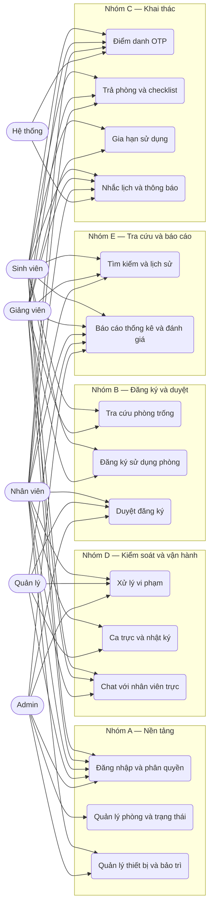
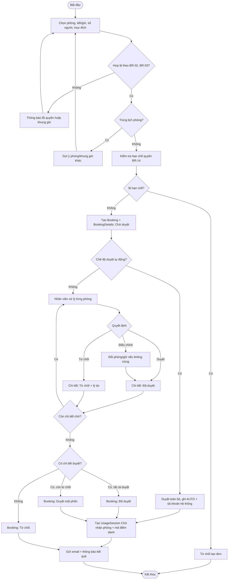
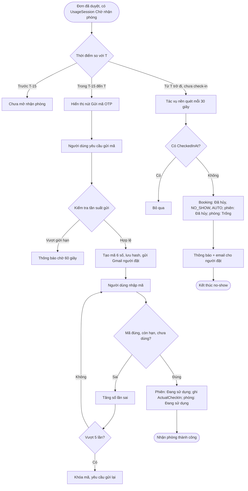
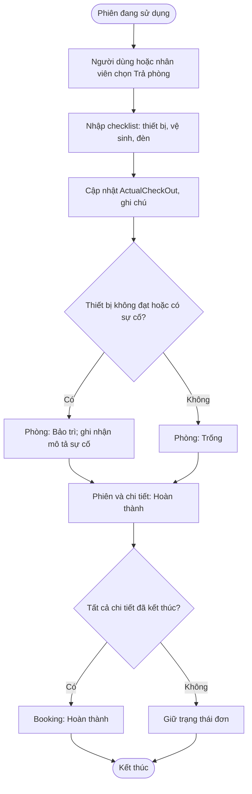
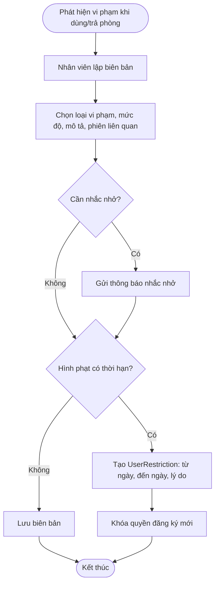

# 02 — Mô hình nghiệp vụ và use case nghiệp vụ

> Tài liệu chuẩn hóa các chức năng trong đề cương thành **15 nghiệp vụ / 5 nhóm**, kèm sơ đồ use case nghiệp vụ, activity diagram và truy vết. Đặc tả chi tiết từng use case hệ thống nằm ở [03-dac-ta-use-case.md](03-dac-ta-use-case.md).

## 1. Nguyên tắc phân rã

Đề cương liệt kê chức năng theo nền tảng (Web/Mobile) và theo bullet, không đánh số nghiệp vụ. Khi mô hình hóa, nhóm phân rã theo **mục tiêu nghiệp vụ**, không theo màn hình:

- Một nghiệp vụ là một chuỗi hoạt động có trigger, kết quả và người chịu trách nhiệm rõ ràng.
- Mobile không phải nghiệp vụ riêng: mobile là **kênh** thực hiện lại các nghiệp vụ NV04–NV10, NV13–NV15.
- Các chức năng CRUD danh mục được gộp theo đối tượng quản lý, trừ khi có quy trình riêng.

Kết quả: **15 nghiệp vụ, 35 use case hệ thống**.

## 2. Danh mục nghiệp vụ

### Nhóm A — Nền tảng và danh mục

| Mã | Nghiệp vụ | Tác nhân chính | Trigger | Kết quả | Use case |
|---|---|---|---|---|---|
| NV01 | Xác thực và phân quyền | Tất cả người dùng | Người dùng mở hệ thống | Phiên đăng nhập hợp lệ, quyền đúng vai trò | UC01–UC04 |
| NV02 | Quản lý phòng, loại phòng, tiết và trạng thái phòng | Admin | Có phòng mới, đổi sử dụng, bảo trì | Danh mục phòng và trạng thái chính xác | UC05–UC08 |
| NV03 | Quản lý thiết bị theo phòng và bảo trì | Admin, Nhân viên | Mua sắm, luân chuyển, hư hỏng | Tài sản được gán đúng phòng, có lịch sử sửa chữa | UC09–UC10 |

### Nhóm B — Đăng ký và duyệt

| Mã | Nghiệp vụ | Tác nhân chính | Trigger | Kết quả | Use case |
|---|---|---|---|---|---|
| NV04 | Tra cứu phòng trống, kiểm tra trùng lịch | Sinh viên, Giảng viên, Nhân viên | Có nhu cầu sử dụng phòng | Danh sách phòng còn trống theo tiết/giờ | UC11–UC12 |
| NV05 | Đăng ký sử dụng phòng | Sinh viên, Giảng viên | Chọn được phòng phù hợp | Đơn ở trạng thái Chờ duyệt | UC13–UC15 |
| NV06 | Duyệt đăng ký | Nhân viên, Quản lý, Admin | Có đơn chờ duyệt | Đơn/chi tiết được duyệt, từ chối hoặc điều chỉnh | UC16–UC19 |

### Nhóm C — Khai thác phòng

| Mã | Nghiệp vụ | Tác nhân chính | Trigger | Kết quả | Use case |
|---|---|---|---|---|---|
| NV07 | Điểm danh nhận phòng bằng OTP | Sinh viên, Giảng viên, Nhân viên | Đến cửa sổ `[T−15, T)` | Phiên sử dụng bắt đầu hoặc bị hủy no-show | UC20–UC23 |
| NV08 | Trả phòng và checklist hiện trạng | Sinh viên, Giảng viên, Nhân viên | Kết thúc sử dụng | Phiên hoàn thành, phòng về trống/bảo trì | UC24 |
| NV09 | Gia hạn thời gian sử dụng | Sinh viên, Giảng viên | Cần dùng thêm | Giờ kết thúc được kéo dài hợp lệ | UC25 |
| NV10 | Nhắc lịch và thông báo | Hệ thống, tất cả người dùng | Mốc thời gian hoặc thay đổi trạng thái | Email/thông báo đến đúng người | UC26–UC28 |

### Nhóm D — Kiểm soát và vận hành

| Mã | Nghiệp vụ | Tác nhân chính | Trigger | Kết quả | Use case |
|---|---|---|---|---|---|
| NV11 | Xử lý vi phạm, khóa quyền đăng ký | Nhân viên, Admin | Phát hiện vi phạm | Biên bản, nhắc nhở, lệnh hạn chế | UC29–UC30 |
| NV12 | Quản lý ca trực và nhật ký trực | Nhân viên, Quản lý | Lịch trực tuần | Ca trực và nhật ký được ghi nhận | UC31 |
| NV13 | Chat với nhân viên trực | Sinh viên, Giảng viên, Nhân viên | Cần hỗ trợ | Hội thoại realtime được lưu | UC32 |

### Nhóm E — Tra cứu, báo cáo, đánh giá

| Mã | Nghiệp vụ | Tác nhân chính | Trigger | Kết quả | Use case |
|---|---|---|---|---|---|
| NV14 | Tìm kiếm và tra cứu lịch sử | Tất cả người dùng | Cần tra một phòng/đơn/biên bản | Kết quả tra cứu theo bộ lọc | UC33 |
| NV15 | Báo cáo thống kê và đánh giá chất lượng | Admin, Quản lý, Nhân viên, Người dùng | Cuối kỳ hoặc sau sử dụng | Báo cáo khai thác; đánh giá được ghi nhận | UC34–UC35 |

## 3. Sơ đồ use case nghiệp vụ

## 4. Activity diagram các nghiệp vụ chính

### 4.1 NV05 + NV06 — Đăng ký và duyệt (duyệt từng phòng)

### 4.2 NV07 — Điểm danh OTP và no-show

### 4.3 NV08 — Trả phòng và checklist

### 4.4 NV11 — Vi phạm và khóa quyền

## 5. Ma trận tác nhân × nghiệp vụ

Ký hiệu: **C** = chủ trì, **P** = tham gia, **X** = xem/tra cứu.

| Nghiệp vụ | Sinh viên | Giảng viên | Nhân viên | Quản lý | Admin | Hệ thống |
|---|---|---|---|---|---|---|
| NV01 Xác thực | P | P | P | P | P | — |
| NV02 Phòng và trạng thái | X | X | P | P | C | — |
| NV03 Thiết bị, bảo trì | — | — | C | P | C | — |
| NV04 Tra cứu trống | C | C | C | X | X | — |
| NV05 Đăng ký | C | C | P | — | P | — |
| NV06 Duyệt | — | — | C | C | C | P (auto) |
| NV07 Điểm danh OTP | C | C | P (hộ) | X | X | C (gửi mã, no-show) |
| NV08 Trả phòng | C | C | C | X | X | — |
| NV09 Gia hạn | C | C | X | — | X | — |
| NV10 Nhắc lịch, thông báo | X | X | X | X | X | C |
| NV11 Vi phạm | X | X | C | P | C | — |
| NV12 Ca trực | — | — | P | C | C | — |
| NV13 Chat | C | C | C | — | X | — |
| NV14 Tìm kiếm, lịch sử | X | X | X | X | X | — |
| NV15 Báo cáo, đánh giá | P (đánh giá) | P (đánh giá) | X | C | C | — |

## 6. Truy vết nghiệp vụ → đề cương

| Nghiệp vụ | Bullet tương ứng trong đề cương |
|---|---|
| NV01 | Mục 6: “đăng nhập, đăng xuất, đổi mật khẩu, phân quyền người dùng” |
| NV02 | “Quản lý trạng thái phòng trống, phòng đang sử dụng, đang bảo trì”; “quản lý danh mục loại phòng, phòng” (tuần 6) |
| NV03 | “Quản lý danh mục thiết bị, quản lý thiết bị theo từng phòng; theo dõi sử dụng thiết bị – tình trạng – ghi nhận hư hỏng sửa chữa” |
| NV04 | “Kiểm tra phòng trống – kiểm tra trùng lịch”; mobile “tra cứu phòng trống” |
| NV05 | “Quản lý đăng ký sử dụng phòng”; mobile “đăng ký sử dụng phòng” |
| NV06 | “Quản lý duyệt mượn phòng: duyệt/từ chối, quy trình duyệt nhiều cấp → điều chỉnh phòng hoặc thời gian → gửi thông báo kết quả qua email ứng dụng di động” |
| NV07 | “Điểm danh bằng QR code” → thay bằng OTP Gmail; “xác nhận nhận phòng” |
| NV08 | “Xác nhận trả phòng (có ghi nhận bất thường khi nhận/trả phòng)” |
| NV09 | “Gia hạn thời gian sử dụng phòng” |
| NV10 | “Gửi thông báo nhắc nhở khi vi phạm nội quy”; “nhắc lịch sắp đến/sắp kết thúc”; “nhận thông báo về tình hình sử dụng phòng” |
| NV11 | “Quản lý xử lý vi phạm sử dụng phòng (khóa quyền đăng ký)” |
| NV12 | “Quản lý lịch trực của nhân viên – ghi nhận nhật ký trực” |
| NV13 | Mobile: “Chat với nhân viên trực” |
| NV14 | “Tìm kiếm: phòng, người mượn, phiếu mượn, biên bản vi phạm”; mobile “xem lịch sử đăng ký/sử dụng/vi phạm” |
| NV15 | “Báo cáo, thống kê: tần suất phòng được sử dụng, tỷ lệ phòng trống theo từng thời điểm”; “tổng hợp, báo cáo kết quả điểm danh”; “gửi phản hồi đánh giá” |

## 7. Đối chiếu nền tảng

| Nghiệp vụ | Web | Mobile | Ghi chú |
|---|---|---|---|
| NV01 | ✔ | ✔ | Mobile dùng cùng API JWT |
| NV02, NV03 | ✔ | — | Chỉ quản trị/nhân sự |
| NV04, NV05 | ✔ | ✔ | Mobile là kênh chính của sinh viên/giảng viên |
| NV06 | ✔ | Xem kết quả | Mobile không duyệt |
| NV07, NV08, NV09 | ✔ | ✔ | OTP nhập trên cả hai nền tảng |
| NV10 | ✔ | ✔ | Mobile ưu tiên push/in-app |
| NV11, NV12 | ✔ | — | Nghiệp vụ nhân sự |
| NV13 | ✔ | ✔ | Chat realtime qua SignalR |
| NV14 | ✔ | ✔ | |
| NV15 | ✔ | Chỉ gửi đánh giá | Báo cáo thuộc web quản trị |
