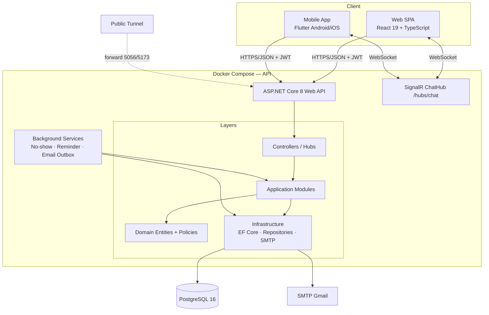
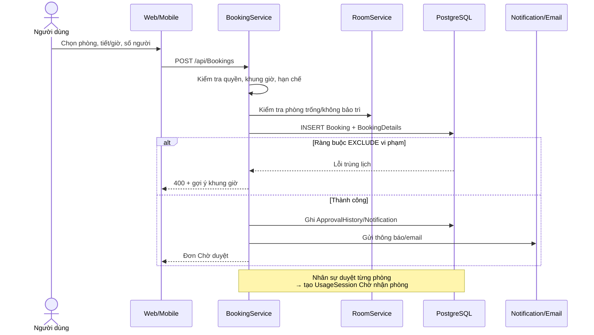
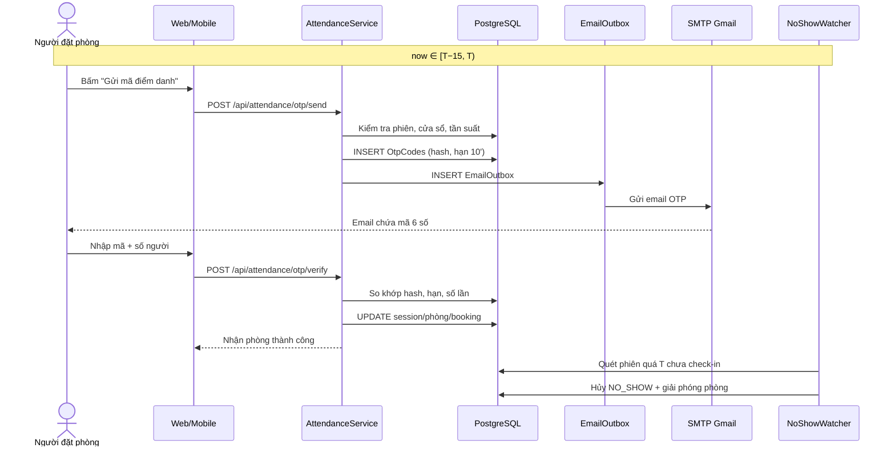
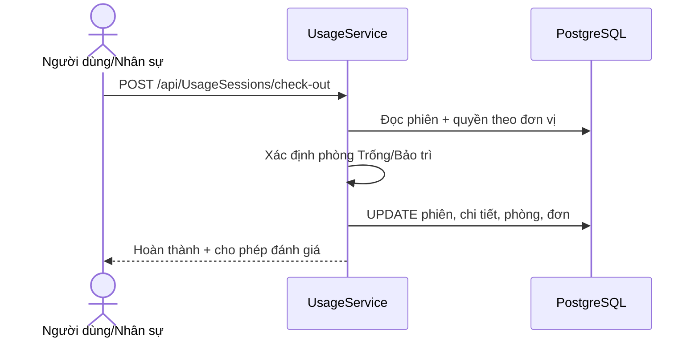
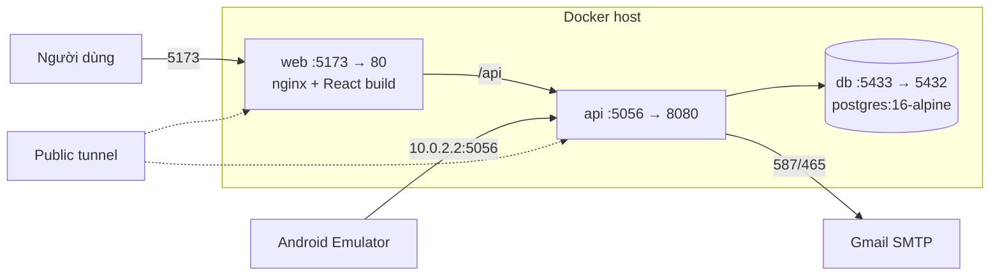

# 04 — Thiết kế kiến trúc hệ thống

> Kiến trúc bám theo mã nguồn hiện có (ASP.NET Core 8, EF Core, PostgreSQL 16, React 19, Flutter) và bổ sung phần còn thiếu cho nghiệp vụ OTP. Tài liệu mô tả **kiến trúc đích**, không phải đề xuất viết lại hệ thống.

## 1. Yêu cầu kiến trúc (architectural drivers)

| Mã | Yêu cầu | Ảnh hưởng thiết kế |
|---|---|---|
| AD-01 | Một nhóm 3 người, hạn 12 tuần | Ưu tiên monolith module hóa, ít hạ tầng vận hành |
| AD-02 | Hai client Web + Mobile dùng chung nghiệp vụ | API REST thống nhất, không nhúng logic vào client |
| AD-03 | Ràng buộc nghiệp vụ phức tạp (tiết học, quyền theo vai trò, trùng lịch) | Logic tập trung ở Application; ràng buộc chống trùng ở CSDL |
| AD-04 | Tác vụ nền (no-show, nhắc lịch, gửi OTP) | BackgroundService + email outbox |
| AD-05 | Dữ liệu phải truy vết được (ai duyệt, ai vi phạm) | Audit columns + `ApprovalHistories` + `AuditLogs` |
| AD-06 | Triển khai demo nhanh, một instance | Docker Compose, SignalR in-memory |
| AD-07 | Bảo mật thông tin đăng nhập và OTP | JWT, hash mật khẩu/OTP, rate limit |

## 2. So sánh phương án

| Tiêu chí | A. Modular monolith N-layer (chọn) | B. Microservices | C. Serverless/BaaS |
|---|---|---|---|
| Thời gian triển khai | Nhanh, phù hợp 12 tuần | Chậm, cần hạ tầng service discovery, message broker | Trung bình, phụ thuộc nền tảng |
| Phù hợp nghiệp vụ | Ràng buộc chéo booking–duyệt–phiên nằm trong một transaction | Phải dùng saga/eventual consistency | Khó kiểm soát transaction |
| Vận hành | 3 container | Nhiều container + observability | Ít vận hành nhưng khóa nhà cung cấp |
| Phù hợp đồ án | Cao, dễ giải thích, dễ demo | Thấp | Thấp |
| Khả năng mở rộng | Theo chiều dọc; tách module khi cần | Cao | Cao |

**Quyết định**: chọn **A**. Hệ thống là monolith nhưng chia module theo bounded context; mỗi module chỉ truy cập dữ liệu của mình qua interface, không gọi trực tiếp DbContext của module khác.

## 3. Kiến trúc tổng thể

### 3.1 Phân lớp

| Lớp | Trách nhiệm | Không được làm |
|---|---|---|
| `Domain` | Entity, trạng thái, quy tắc thuần (policy), hằng số | Phụ thuộc EF Core, HTTP, SMTP |
| `Application` | Use case/service, DTO, interface repository, điều phối transaction | Viết SQL trực tiếp, đọc `HttpContext` |
| `Infrastructure` | EF Core, migration, repository, SMTP, stored procedure | Chứa quy tắc nghiệp vụ |
| `API` | Controller mỏng, xác thực, mapping HTTP, background host | Truy vấn DB trực tiếp |

Luồng phụ thuộc một chiều: `API → Application → Domain`, `Infrastructure → Application/Domain`.

### 3.2 Module nghiệp vụ

| Module | Use case | Bảng chính |
|---|---|---|
| Identity | UC01–UC04 | `AspNetUsers`, `AspNetRoles`, `UserRoles`, `UserRestrictions` |
| Room / Catalog | UC05–UC09, UC11–UC12 | `Rooms`, `RoomTypes`, `Periods`, `WorkingHours`, `Equipments`, `RoomEquipments` |
| Booking | UC13–UC19 | `Bookings`, `BookingDetails`, `ApprovalHistories`, `ApprovalSteps`* |
| Attendance (bổ sung) | UC20–UC23 | `UsageSessions`, `OtpCodes`* |
| Usage | UC24–UC25 | `UsageSessions`, `UsageConditions`, `BookingExtensions`, `EquipmentConditionLogs` |
| Notification | UC26–UC28 | `Notifications`, `EmailOutbox`* |
| Violation | UC29–UC30 | `ViolationTypes`, `ViolationRecords`, `UserRestrictions` |
| Shift | UC31 | `Shifts`, `EmployeeShift`, `ShiftLogs` |
| Chat | UC32 | `ChatConversations`, `ChatMessages` |
| Report | UC33–UC34 | Đọc qua view/function |
| Feedback | UC35 | `Feedbacks` |
| Department / Settings | Danh mục, cấu hình | `Departments`, `SystemSettings` |

`*` bảng bổ sung, xem [05-thiet-ke-csdl.md](05-thiet-ke-csdl.md).

## 4. Luồng nghiệp vụ chính

### 4.1 Đăng ký và duyệt

### 4.2 Điểm danh OTP (thay QR)

### 4.3 Trả phòng

## 5. Thiết kế API

- Chuẩn response: `{ success, message, data }`; lỗi nghiệp vụ 400, chưa đăng nhập 401, thiếu quyền 403, không tìm thấy 404, trùng lịch 409.
- Xác thực: Bearer JWT, thời hạn 7 ngày; thiếu refresh/logout là **nợ kỹ thuật đã biết**.
- Phân quyền: kiểm tra ở controller bằng `[Authorize(Roles=...)]` **và** kiểm tra nghiệp vụ trong service (đơn vị, chủ sở hữu, loại phòng).
- Idempotency: các thao tác trạng thái (duyệt, check-in, trả phòng) phải kiểm tra trạng thái hiện tại trước khi cập nhật; no-show dùng cập nhật có điều kiện để tránh xử lý hai lần.
- API mới cho OTP: xem [06-diem-danh-otp.md §8](06-diem-danh-otp.md#8-thiết-kế-api).

## 6. Nhất quán dữ liệu và giao dịch

| Cơ chế | Áp dụng |
|---|---|
| Transaction EF Core | Tạo đơn + chi tiết; duyệt + tạo phiên + audit; check-in + cập nhật phòng/đơn |
| `EXCLUDE USING gist` | Chống trùng lịch ở tầng CSDL, kể cả khi có import SQL trực tiếp |
| Unique index có filter | `RoomCode`, `UsageSession.BookingDetailId`, `ConfirmationCode` chỉ trên bản ghi sống |
| Cập nhật có điều kiện | No-show chỉ hủy khi `CheckedInAt IS NULL` và trạng thái còn “Chờ nhận phòng” |
| Soft delete | Global query filter; báo cáo lịch sử cân nhắc `IgnoreQueryFilters` có kiểm soát |
| Email outbox | Ghi DB trước, gửi sau; retry có backoff; không chặn giao dịch chính |

**Nợ kỹ thuật**: 9 stored procedure được gọi nhưng chưa có migration tạo, lỗi bị nuốt trong `try/catch`. Kiến trúc đích phải hoặc tạo migration cho chúng, hoặc bỏ lời gọi và chuyển logic sang Application.

## 7. Bảo mật

| Hạng mục | Hiện trạng | Kiến trúc đích |
|---|---|---|
| Mật khẩu | ASP.NET Identity hash | Giữ nguyên, yêu cầu độ dài tối thiểu cao hơn |
| OTP quên mật khẩu | Trả mã trong response, không kiểm tra | Bảng OTP dùng chung, hash, hạn, số lần nhập |
| OTP điểm danh | Chưa có | HMAC-SHA256 + pepper, so sánh constant-time, dùng một lần |
| JWT | 7 ngày, không refresh/thu hồi | Bổ sung refresh token + thu hồi khi khóa tài khoản (khuyến nghị) |
| CORS | Cho mọi origin kèm credentials | Giới hạn origin theo môi trường |
| Bí mật | App password SMTP nằm trong `appsettings.json` | Chuyển sang biến môi trường/secret, xoay khóa |
| Phân quyền | Attribute + kiểm tra service | Bổ sung policy tập trung cho từng module |
| Dữ liệu nhạy cảm | Không log mật khẩu/OTP | Cấm log plaintext OTP; che email |

## 8. Triển khai

| Thành phần | Cấu hình |
|---|---|
| `db` | PostgreSQL 16, volume bền vững, healthcheck |
| `api` | ASP.NET Core 8, `Database__AutoMigrate=true` khi container, seed idempotent |
| `web` | Build Vite, phục vụ qua nginx, `VITE_API_URL` |
| Mobile | `AppConfig` trỏ `http://10.0.2.2:5056` trên emulator |
| Tunnel | Quick tunnel cho demo, URL thay đổi mỗi lần chạy |

## 9. Yêu cầu phi chức năng

| Mã | Hạng mục | Mục tiêu |
|---|---|---|
| NFR-01 | Hiệu năng đọc | Danh sách phòng/lịch ≤ 500 ms p95 với dữ liệu seed |
| NFR-02 | Hiệu năng ghi | Tạo đơn ≤ 1 s, gồm kiểm tra trùng lịch |
| NFR-03 | Đồng thời | 200 kết nối; SignalR một instance |
| NFR-04 | Sẵn sàng | Tác vụ nền chạy lặp an toàn; API restart không mất dữ liệu |
| NFR-05 | Khả năng bảo trì | Module tách biệt, policy thuần có test |
| NFR-06 | Khả năng kiểm thử | Unit test policy + integration test service + test OTP bảo mật |
| NFR-07 | Sao lưu | Dump PostgreSQL hằng ngày; thời gian phục hồi mục tiêu ≤ 1 giờ |
| NFR-08 | Khả năng quan sát | Log có correlation id; log lỗi gửi email; không log OTP |

## 10. Quyết định kiến trúc (ADR tóm tắt)

| ADR | Quyết định | Lý do | Hệ quả |
|---|---|---|---|
| ADR-01 | Modular monolith thay vì microservices | Thời gian, độ phức tạp, transaction | Tách module khi cần; không scale độc lập |
| ADR-02 | PostgreSQL làm nguồn sự thật cho trùng lịch | Chống race condition | Cần `btree_gist`; lỗi DB phải map thành lỗi nghiệp vụ |
| ADR-03 | OTP thay QR cho điểm danh | Không cần thiết bị quét, tận dụng email trường | Không chứng minh hiện diện; cần đối chiếu ngẫu nhiên |
| ADR-04 | Email outbox thay gửi đồng bộ | Không chặn nghiệp vụ, có retry | Thêm bảng và worker |
| ADR-05 | Soft delete toàn hệ thống | Yêu cầu dự án, bảo toàn lịch sử | Query phải lọc; unique index có filter |
| ADR-06 | SignalR in-memory | Một instance | Không scale ngang nếu không có backplane |

## 11. Khoảng trống giữa kiến trúc đích và mã nguồn

| # | Khoảng trống | Ảnh hưởng | Ưu tiên |
|---|---|---|---|
| 1 | Chưa có `OtpCodes`, OTP quên mật khẩu không kiểm tra | Không đáp ứng điểm danh OTP, lỗ hổng bảo mật | P0 |
| 2 | Chưa có `ApprovalSteps` (duyệt nhiều cấp) | Đề cương yêu cầu, code chỉ 1 cấp | P1 |
| 3 | Không có điều chỉnh phòng/giờ khi duyệt | Thiếu nghiệp vụ NV06 | P1 |
| 4 | Stored procedure gọi nhưng chưa tạo | Lỗi bị nuốt, hành vi không rõ | P1 |
| 5 | Bảng `MaintenanceRecords`, `EquipmentConditionLogs`, `UsageConditions` chưa dùng | NV03/NV08 chưa đầy đủ | P1 |
| 6 | Không có refresh/logout server-side | Token bị lộ vẫn dùng được 7 ngày | P1 |
| 7 | Không push thông báo realtime, email nhắc lịch/no-show | NV10 chưa hoàn chỉnh | P2 |
| 8 | CORS mở mọi origin | Rủi ro bảo mật khi public | P2 |
| 9 | `docs/api.md` lệch so với code (thiếu extend, forgot-password) | Tài liệu không đồng bộ | P2 |
