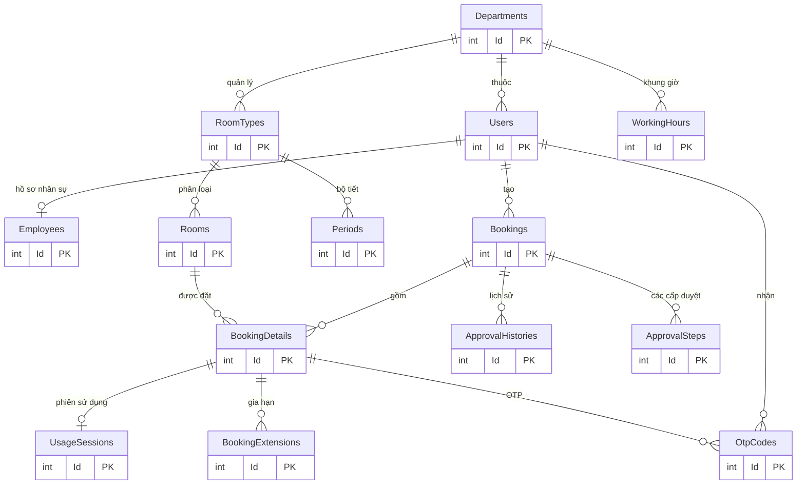
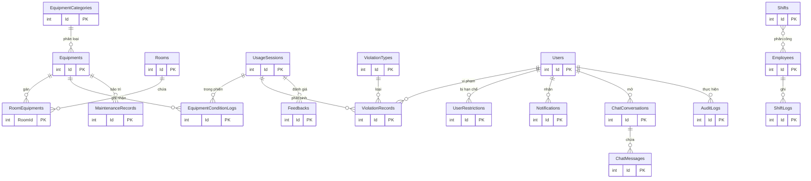

# 05 — Thiết kế cơ sở dữ liệu

> CSDL đích: **PostgreSQL 16**. Tài liệu mô tả cấu trúc hiện có trong mã nguồn (28 bảng nghiệp vụ + 7 bảng Identity, trong đó `AspNetUsers` đóng vai bảng `Users`) và **5 bảng bổ sung** cho các nghiệp vụ chưa triển khai. Tên bảng/cột giữ nguyên PascalCase như EF Core đang map và được PostgreSQL trích dẫn bằng dấu `"`.

## 1. Nguyên tắc thiết kế

| Mã | Nguyên tắc |
|---|---|
| DB-01 | Khóa chính số nguyên `integer` sinh tự động (`GENERATED BY DEFAULT AS IDENTITY`). |
| DB-02 | Thời gian lưu `timestamptz` theo UTC; ứng dụng đổi sang UTC+7 khi hiển thị. |
| DB-03 | Mọi bảng nghiệp vụ kế thừa `BaseEntity`: `CreatedAt`, `UpdatedAt`, `IsDeleted`; không hard-delete. |
| DB-04 | Trạng thái lưu chuỗi tiếng Việt chuẩn hóa và bị chặn bằng `CHECK` constraint (trừ một số cột `int` có quy ước riêng). |
| DB-05 | Khóa ngoại `ON DELETE RESTRICT` toàn hệ thống; dọn dẹp bằng xóa mềm. |
| DB-06 | Unique index có điều kiện `WHERE "IsDeleted" = FALSE` cho mã/khóa nghiệp vụ. |
| DB-07 | Chống trùng lịch bằng `EXCLUDE USING gist` trên `(RoomId =, tstzrange(StartAt, EndAt, '[)') &&)`. |
| DB-08 | Không lưu plaintext OTP/mật khẩu; chỉ lưu hash. |
| DB-09 | Báo cáo đọc bằng view/function, không ghi vào bảng tổng hợp nếu chưa cần. |

## 2. Sơ đồ thực thể liên kết

### 2.1 Lõi: tổ chức – phòng – đặt phòng – duyệt



### 2.2 Vận hành: thiết bị – vi phạm – trực – thông báo – phản hồi



## 3. Từ điển dữ liệu

Quy ước: mọi bảng nghiệp vụ có thêm `"CreatedAt" timestamptz NOT NULL`, `"UpdatedAt" timestamptz NULL`, `"IsDeleted" boolean NOT NULL DEFAULT false` — không lặp lại trong từng bảng.

### 3.1 Nhóm tổ chức và người dùng

#### `Users` (thực tế EF map thành `AspNetUsers` do kế thừa `IdentityDbContext`)

| Cột | Kiểu | Ràng buộc | Mô tả |
|---|---|---|---|
| `Id` | integer | PK, identity | Khóa người dùng |
| `UserName` | varchar(256) | unique (Identity) | Tên đăng nhập |
| `NormalizedUserName` | varchar(256) | unique | Chuẩn hóa |
| `Email` | varchar(256) | unique, nullable | Email HUIT — **đích gửi OTP** |
| `PasswordHash` | text | | Hash mật khẩu |
| `SecurityStamp` | text | | Identity |
| `CardCode` | varchar(50) | NOT NULL | MSSV/mã cán bộ |
| `FullName` | varchar(255) | NOT NULL | Họ tên |
| `Status` | varchar | | `Hoạt động`/`Active`/khóa |
| `DepartmentId` | integer | FK → Departments, nullable | Đơn vị |
| `CreatedAt`/`UpdatedAt`/`IsDeleted` | | | Kế thừa trực tiếp `ISoftDelete` |

> Ghi chú: entity có `[Table("Users")]` nhưng migration/snapshot tạo `AspNetUsers`. Tài liệu dùng **`AspNetUsers`** làm tên vật lý; cần thống nhất trước khi viết báo cáo.

#### `Departments`

| Cột | Kiểu | Ràng buộc | Mô tả |
|---|---|---|---|
| `Id` | integer | PK | |
| `Name` | varchar(255) | NOT NULL | Tên đơn vị (Thư viện, Phòng Đào tạo) |
| `Type` | varchar(100) | | Loại đơn vị |
| `Status` | varchar | | Trạng thái hoạt động |

#### `Employees`

| Cột | Kiểu | Ràng buộc | Mô tả |
|---|---|---|---|
| `Id` | integer | PK | |
| `Code` | varchar(50) | NOT NULL | Mã nhân viên |
| `Position` | varchar(100) | | Chức vụ |
| `HireDate` | timestamptz | nullable | Ngày vào làm |
| `Status` | varchar | | Trạng thái |
| `UserId` | integer | FK → AspNetUsers, unique | 1-1 với tài khoản |

#### `SystemSettings`

| Cột | Kiểu | Ràng buộc | Mô tả |
|---|---|---|---|
| `Key` | varchar(100) | PK | Ví dụ `booking.autoApprove` |
| `Value` | varchar(255) | | `true`/`false` |
| `UpdatedAt` | timestamptz | NOT NULL | |
| `UpdatedByUserId` | integer | FK → AspNetUsers, nullable | Truy vết người đổi |

#### `UserRestrictions`

| Cột | Kiểu | Ràng buộc | Mô tả |
|---|---|---|---|
| `Id` | integer | PK | |
| `RestrictionType` | varchar(100) | | `BOOKING_BAN`… |
| `Reason` | text | | Lý do |
| `StartAt`/`EndAt` | timestamptz | `EndAt` nullable | Hiệu lực |
| `Status` | varchar | | `Hiệu lực`/`Hết hạn`/`Đã gỡ` |
| `UserId` | integer | FK → AspNetUsers | Người bị hạn chế |

### 3.2 Nhóm danh mục phòng

#### `RoomTypes`

| Cột | Kiểu | Ràng buộc | Mô tả |
|---|---|---|---|
| `Id` | integer | PK | |
| `Name` | varchar(255) | NOT NULL | Loại phòng |
| `Description` | text | | |
| `DefaultCapacity` | integer | CHECK > 0 | Sức chứa mặc định |
| `Status` | varchar | | |
| `DepartmentId` | integer | FK → Departments, nullable | Đơn vị quản lý (phân quyền duyệt) |
| `IsBookingByPeriod` | boolean | NOT NULL | Đặt theo tiết hay theo giờ |

#### `Rooms`

| Cột | Kiểu | Ràng buộc | Mô tả |
|---|---|---|---|
| `Id` | integer | PK | |
| `Name` | varchar(255) | NOT NULL | Tên phòng |
| `RoomCode` | varchar(50) | NOT NULL, unique filtered | Mã phòng (A101…) |
| `Floor` | varchar(50) | | Tầng |
| `Building` | varchar(50) | | Tòa |
| `RoomNumber` | varchar(50) | | Số phòng |
| `Capacity` | integer | CHECK > 0 | Sức chứa |
| `Status` | varchar | CHECK IN (`Trống`, `Đang sử dụng`, `Bảo trì`) | Trạng thái |
| `Description` | text | | Ghi chú (có thể chứa thông tin bảo trì) |
| `RoomTypeId` | integer | FK → RoomTypes | Loại phòng |

#### `Periods`

| Cột | Kiểu | Ràng buộc | Mô tả |
|---|---|---|---|
| `Id` | integer | PK | |
| `Name` | varchar(50) | NOT NULL | “Tiết 1”… |
| `StartTime`/`EndTime` | time | CHECK `EndTime > StartTime` | Giờ tiết |
| `RoomTypeId` | integer | FK → RoomTypes, nullable | Bộ tiết theo loại phòng |

#### `WorkingHours`

| Cột | Kiểu | Ràng buộc | Mô tả |
|---|---|---|---|
| `Id` | integer | PK | |
| `DepartmentId` | integer | FK → Departments | Đơn vị |
| `DayOfWeek` | integer | CHECK 0–6 | 0 = Chủ Nhật |
| `OpenTime`/`CloseTime` | time | CHECK khi không đóng | Giờ phục vụ |
| `IsClosed` | boolean | NOT NULL | Ngày nghỉ |

Unique filtered `(DepartmentId, DayOfWeek) WHERE IsDeleted = FALSE`.

#### `UsageConditions` / `RoomTypeConditions`

| Bảng | Cột chính | Mô tả |
|---|---|---|
| `UsageConditions` | `Id`, `Name` varchar(255), `Code` varchar(50), `Content` text, `Type` int, `Status` | Danh mục điều kiện/nội quy sử dụng |
| `RoomTypeConditions` | PK (`RoomTypeId`, `UsageConditionId`), `Value` text, `IsRequired` bool | Gán điều kiện cho loại phòng |

> Hai bảng đã có nhưng chưa được service sử dụng; thiết kế đích dùng chúng cho **checklist bàn giao theo loại phòng**.

### 3.3 Nhóm thiết bị

#### `EquipmentCategories`

| Cột | Kiểu | Ràng buộc | Mô tả |
|---|---|---|---|
| `Id` | integer | PK | |
| `Name` | varchar(255) | NOT NULL | Danh mục |
| `Description` | text | | |

#### `Equipments`

| Cột | Kiểu | Ràng buộc | Mô tả |
|---|---|---|---|
| `Id` | integer | PK | |
| `Code` | varchar(50) | NOT NULL | Mã thiết bị |
| `Name` | varchar(255) | NOT NULL | Tên |
| `PurchaseDate` | timestamptz | nullable | Ngày mua |
| `Status` | varchar | | Tình trạng |
| `Description` | text | | |
| `TotalQuantity` | integer | DEFAULT 0 | Tổng số lượng |
| `AvailableQuantity` | integer | DEFAULT 0 | Sẵn có |
| `EquipmentCategoryId` | integer | FK → EquipmentCategories | Danh mục |

#### `RoomEquipments`

| Cột | Kiểu | Ràng buộc | Mô tả |
|---|---|---|---|
| `RoomId` | integer | PK, FK → Rooms | |
| `EquipmentId` | integer | PK, FK → Equipments | |
| `AssignedDate` | timestamptz | NOT NULL | Ngày gán |
| `RemovedDate` | timestamptz | nullable | Ngày thu hồi |
| `Quantity` | integer | | Số lượng |
| `Status` | varchar | | Tình trạng trong phòng |

#### `EquipmentConditionLogs`

| Cột | Kiểu | Mô tả |
|---|---|---|
| `Id` | integer PK | |
| `ConditionBefore` / `ConditionAfter` | text | Tình trạng trước/sau |
| `Note` | text | Ghi chú |
| `RecordedAt` | timestamptz | |
| `UsageSessionId` | integer FK | Phiên liên quan |
| `EquipmentId` | integer FK | Thiết bị |

#### `MaintenanceRecords`

| Cột | Kiểu | Mô tả |
|---|---|---|
| `Id` | integer PK | |
| `IssueType` | varchar(100) | Loại sự cố |
| `IssueDescription` | text | Mô tả |
| `DetectedDate` | timestamptz | Phát hiện |
| `StartDate` / `CompletionDate` | timestamptz nullable | Sửa chữa |
| `Status` | varchar | Trạng thái |
| `EquipmentId` | integer FK | Thiết bị |
| `EmployeeId` | integer FK | Người phụ trách |

### 3.4 Nhóm đặt phòng và duyệt

#### `Bookings`

| Cột | Kiểu | Ràng buộc | Mô tả |
|---|---|---|---|
| `Id` | integer | PK | |
| `ActivityName` | varchar(255) | | Tên hoạt động |
| `Purpose` | text | | Mục đích |
| `GuestCount` | integer | CHECK > 0 | Số khách dự kiến |
| `RequestedAt` | timestamptz | NOT NULL | Thời điểm gửi |
| `Status` | varchar | CHECK 7 giá trị | Trạng thái đơn |
| `RejectionReason` | text | | Lý do từ chối |
| `Note` | text | | Ghi chú |
| `CheckedInAt` | timestamptz | nullable | Mốc nhận phòng cấp đơn (chống no-show) |
| `CancelReason` | varchar(50) | nullable | `CHANGE_PLAN`/`NO_LONGER_NEEDED`/`OTHER`/`NO_SHOW` |
| `CancelReasonDetail` | varchar(1000) | nullable | Bắt buộc khi `OTHER` |
| `CancelSource` | varchar(20) | nullable | `STUDENT`/`AUTO`/`STAFF` |
| `ApprovedByUserId` | integer | FK → AspNetUsers, nullable | Người duyệt |
| `ApprovedAt` | timestamptz | nullable | |
| `ApprovalMode` | varchar(10) | CHECK `MANUAL`/`AUTO` | Chế độ duyệt |
| `UserId` | integer | FK → AspNetUsers | Người đặt |

Ràng buộc `CK_Bookings_Approval_Audit`: hoặc cả 3 cột duyệt đều NULL, hoặc cả 3 đều có giá trị hợp lệ.

#### `BookingDetails`

| Cột | Kiểu | Ràng buộc | Mô tả |
|---|---|---|---|
| `Id` | integer | PK | |
| `StartAt` / `EndAt` | timestamptz | CHECK `EndAt > StartAt` | Khoảng sử dụng |
| `GuestCount` | integer | CHECK > 0 | Số người |
| `Purpose` | text | | |
| `Status` | varchar | CHECK 6 giá trị | Trạng thái từng phòng |
| `RejectionReason` | text | | |
| `ApprovedByUserId` / `ApprovedAt` / `ApprovalMode` | | Như `Bookings` | Audit duyệt từng phòng |
| `BookingId` | integer | FK → Bookings | |
| `RoomId` | integer | FK → Rooms | |
| `StartPeriodId` / `EndPeriodId` | integer | FK → Periods, nullable | Đặt theo tiết |

Ràng buộc chống trùng:
```sql
ALTER TABLE "BookingDetails"
ADD CONSTRAINT "EX_BookingDetails_Room_NoOverlap"
EXCLUDE USING gist (
    "RoomId" WITH =,
    tstzrange("StartAt", "EndAt", '[)') WITH &&
)
WHERE ("IsDeleted" = FALSE AND "Status" NOT IN ('Từ chối', 'Đã hủy'));
```

#### `ApprovalHistories`

| Cột | Kiểu | Mô tả |
|---|---|---|
| `Id` | integer PK | |
| `Status` | integer | 1 Duyệt, 2 Từ chối, 3 Duyệt một phần, 4 Hủy bởi nhân sự |
| `Comment` | text | Ý kiến |
| `DecidedAt` | timestamptz | |
| `BookingId` | integer FK | |
| `EmployeeId` | integer FK nullable | Hồ sơ nhân sự |
| `ActorUserId` | integer FK nullable | Tài khoản quyết định |
| `ApprovalMode` | varchar(10) | `MANUAL`/`AUTO` |

CHECK: có ít nhất một chủ thể (`ActorUserId`, `EmployeeId`, hoặc `AUTO`).

#### `ApprovalSteps` — **bổ sung**

| Cột | Kiểu | Ràng buộc | Mô tả |
|---|---|---|---|
| `Id` | integer | PK | |
| `BookingId` | integer | FK → Bookings | Đơn |
| `StepOrder` | integer | CHECK > 0 | Thứ tự cấp duyệt |
| `RequiredRole` | varchar(30) | | `Employee`/`Manager`/`Admin` |
| `DepartmentId` | integer | FK → Departments, nullable | Phạm vi đơn vị |
| `Status` | varchar(20) | CHECK (`Chờ duyệt`,`Đã duyệt`,`Từ chối`,`Bỏ qua`) | Trạng thái cấp |
| `DecidedByUserId` | integer | FK → AspNetUsers, nullable | |
| `DecidedAt` | timestamptz | nullable | |
| `Comment` | text | | |
| `ApprovalMode` | varchar(10) | CHECK `MANUAL`/`AUTO` | |

Unique `(BookingId, StepOrder)`. Thiết kế này tương thích ngược: đơn một cấp chỉ có một bước.

#### `BookingExtensions`

| Cột | Kiểu | Mô tả |
|---|---|---|
| `Id` | integer PK | |
| `BookingDetailId` | integer FK | |
| `UsageSessionId` | integer FK | |
| `PreviousEndAt` / `NewEndAt` | timestamptz | CHECK `NewEndAt > PreviousEndAt` |
| `PreviousEndPeriodId` / `NewEndPeriodId` | integer nullable | |
| `Status` | varchar(30) | Hiện chỉ `Đã áp dụng` |
| `Note` | varchar(2000) | |
| `RequestedAt` | timestamptz | |
| `RequestedByUserId` | integer FK | |

### 3.5 Nhóm khai thác và điểm danh

#### `UsageSessions`

| Cột | Kiểu | Ràng buộc | Mô tả |
|---|---|---|---|
| `Id` | integer | PK | |
| `ActualCheckIn` / `ActualCheckOut` | timestamptz | CHECK out ≥ in | |
| `Status` | varchar | CHECK 4 giá trị | Chờ nhận phòng/Đang sử dụng/Hoàn thành/Đã hủy |
| `ConfirmationCode` | varchar(50) | unique filtered | Mã nhận phòng tĩnh hiện tại |
| `ActualGuestCount` | integer | CHECK > 0 hoặc NULL | Số người thực tế |
| `StaffNote` | varchar(2000) | | Ghi chú nhân sự |
| `DevicesOk` / `Cleaned` / `LightsOff` | boolean | nullable | Checklist trả phòng |
| `UserId` | integer | FK → AspNetUsers | Người chịu trách nhiệm |
| `BookingDetailId` | integer | FK, unique filtered | 1 chi tiết ↔ 1 phiên sống |

#### `OtpCodes` — **bổ sung**

| Cột | Kiểu | Ràng buộc | Mô tả |
|---|---|---|---|
| `Id` | bigint | PK | |
| `Purpose` | varchar(20) | CHECK (`ROOM_CHECK_IN`,`PASSWORD_RESET`) | Dùng chung cho điểm danh và quên mật khẩu |
| `UserId` | integer | FK → AspNetUsers | Người nhận |
| `Email` | varchar(256) | NOT NULL | Email nhận (chụp tại thời điểm gửi) |
| `BookingId` | integer | FK → Bookings, nullable | Bắt buộc khi `ROOM_CHECK_IN` |
| `BookingDetailId` | integer | FK → BookingDetails, nullable | |
| `CodeHash` | varchar(128) | NOT NULL | HMAC-SHA256 hex |
| `SentAt` | timestamptz | NOT NULL | |
| `ExpiresAt` | timestamptz | NOT NULL | `min(SentAt + 10 phút, T)` |
| `AttemptCount` | integer | DEFAULT 0, CHECK 0–5 | Số lần nhập sai |
| `ResentCount` | integer | DEFAULT 0, CHECK 0–3 | Số lần gửi lại |
| `ConsumedAt` | timestamptz | nullable | Đã dùng |
| `IsActive` | boolean | NOT NULL DEFAULT true | Mã còn hiệu lực (dùng cho unique index) |
| `DeliveryStatus` | varchar(20) | CHECK (`PENDING`,`SENT`,`FAILED`) | Trạng thái gửi |
| `CreatedAt` | timestamptz | NOT NULL | |
| `UpdatedAt` | timestamptz | nullable | |
| `IsDeleted` | boolean | NOT NULL DEFAULT false | Xóa mềm theo DB-03 |

> Một bảng dùng chung cho điểm danh và quên mật khẩu để tránh hai cơ chế OTP song song; cột `Purpose` quyết định ngữ cảnh. Unique index `(BookingDetailId, Purpose) WHERE IsActive = true AND IsDeleted = false` bảo đảm mỗi chi tiết chỉ có một mã còn hiệu lực.

#### `RoomStatusHistory` — **bổ sung**

| Cột | Kiểu | Mô tả |
|---|---|---|
| `Id` | bigint PK | |
| `RoomId` | integer FK | |
| `FromStatus` / `ToStatus` | varchar | |
| `Reason` | text | |
| `ChangedByUserId` | integer FK nullable | NULL nếu hệ thống |
| `ChangedAt` | timestamptz | |

### 3.6 Nhóm vi phạm, thông báo, phản hồi

#### `ViolationTypes`

| Cột | Kiểu | Mô tả |
|---|---|---|
| `Id` | integer PK | |
| `Code` | varchar(50) | Mã loại |
| `Name` | varchar(255) | Tên |
| `Description` | text | |
| `Severity` | integer | Mức độ |
| `DefaultPenalty` | text | Hình phạt mặc định |

#### `ViolationRecords`

| Cột | Kiểu | Mô tả |
|---|---|---|
| `Id` | integer PK | |
| `Code` | varchar(50) | Mã biên bản |
| `IncidentTime` | timestamptz | Thời điểm |
| `Description` | text | |
| `Severity` | integer | |
| `PenaltyApplied` | text | |
| `Status` | varchar | |
| `UserId` | integer FK | Người vi phạm |
| `UsageSessionId` | integer FK nullable | Phiên liên quan |
| `ViolationTypeId` | integer FK | Loại vi phạm |

#### `Notifications`

| Cột | Kiểu | Mô tả |
|---|---|---|
| `Id` | integer PK | |
| `Title` | varchar(255) | |
| `Content` | text | |
| `Type` | integer | Loại thông báo |
| `IsRead` | boolean | |
| `SentAt` / `ReadAt` | timestamptz | |
| `UserId` | integer FK | |

#### `Feedbacks`

| Cột | Kiểu | Mô tả |
|---|---|---|
| `Id` | integer PK | |
| `Rating` | integer | 1–5 |
| `Comment` | text | |
| `UserId` | integer FK | |
| `UsageSessionId` | integer FK | |

#### `EmailOutbox` — **bổ sung**

| Cột | Kiểu | Mô tả |
|---|---|---|
| `Id` | bigint PK | |
| `ToEmail` | varchar(256) | |
| `Subject` | varchar(255) | |
| `BodyHtml` | text | |
| `TemplateCode` | varchar(50) | `BOOKING_APPROVED`, `CHECKIN_OTP`… |
| `RelatedEntityType` | varchar(50) | `Booking`/`CheckInOtp` |
| `RelatedEntityId` | integer | |
| `Status` | varchar(20) | `PENDING`/`SENT`/`FAILED` |
| `Attempts` | integer | |
| `NextAttemptAt` | timestamptz | Backoff |
| `LastError` | text | |
| `SentAt` | timestamptz | |
| `CreatedAt` | timestamptz | |

#### `AuditLogs` — **bổ sung**

| Cột | Kiểu | Mô tả |
|---|---|---|
| `Id` | bigint PK | |
| `ActorUserId` | integer FK nullable | |
| `Action` | varchar(50) | `APPROVE`, `CHECK_IN`, `OVERRIDE`… |
| `EntityType` | varchar(50) | |
| `EntityId` | integer | |
| `BeforeJson` / `AfterJson` | jsonb | |
| `IpAddress` | varchar(45) | |
| `OccurredAt` | timestamptz | |

### 3.7 Nhóm vận hành

#### `Shifts`

| Cột | Kiểu | Mô tả |
|---|---|---|
| `Id` | integer PK | |
| `Date` | timestamptz | Ngày trực |
| `Name` | varchar(100) | Ca sáng/chiều… |
| `StartTime` / `EndTime` | time | |
| `Status` | varchar | |

`EmployeeShift` là bảng nối nhiều-nhiều (`ShiftId`, `EmployeeId`) do EF tự sinh.

#### `ShiftLogs`

| Cột | Kiểu | Mô tả |
|---|---|---|
| `Id` | integer PK | |
| `LogTime` | timestamptz | |
| `Content` | text | Nội dung nhật ký |
| `Type` | integer | Loại |
| `EmployeeId` | integer FK | |

#### `ChatConversations`

| Cột | Kiểu | Mô tả |
|---|---|---|
| `Id` | integer PK | |
| `StartTime` / `EndTime` | timestamptz | |
| `Status` | varchar | |
| `UserId` | integer FK | Người yêu cầu hỗ trợ |

#### `ChatMessages`

| Cột | Kiểu | Mô tả |
|---|---|---|
| `Id` | integer PK | |
| `Content` | text | |
| `SentAt` | timestamptz | |
| `IsRead` | boolean | |
| `ChatConversationId` | integer FK | |
| `UserId` | integer FK | Người gửi |

## 4. Danh mục trạng thái

| Nhóm | Giá trị | Ghi chú |
|---|---|---|
| `Bookings.Status` | Chờ duyệt, Đã duyệt, Duyệt một phần, Từ chối, Đã hủy, Đang sử dụng, Hoàn thành | CHECK |
| `BookingDetails.Status` | Chờ duyệt, Đã duyệt, Từ chối, Đã hủy, Đang sử dụng, Hoàn thành | CHECK |
| `UsageSessions.Status` | Chờ nhận phòng, Đang sử dụng, Hoàn thành, Đã hủy | CHECK |
| `Rooms.Status` | Trống, Đang sử dụng, Bảo trì | CHECK |
| `BookingExtensions.Status` | Đã áp dụng | CHECK |
| `ApprovalMode` | MANUAL, AUTO | CHECK |
| `Booking.CancelReason` | CHANGE_PLAN, NO_LONGER_NEEDED, OTHER, NO_SHOW | Không CHECK, validate ở service |
| `Booking.CancelSource` | STUDENT, AUTO, STAFF | Không CHECK |
| `ApprovalHistories.Status` | 1 Duyệt, 2 Từ chối, 3 Duyệt một phần, 4 Hủy bởi nhân sự | int |
| `OtpCodes.Purpose` | ROOM_CHECK_IN, PASSWORD_RESET | Bổ sung |
| `OtpCodes.DeliveryStatus` | PENDING, SENT, FAILED | Bổ sung |

## 5. Ràng buộc và chỉ mục

### 5.1 Đã có

| Đối tượng | Loại | Định nghĩa |
|---|---|---|
| `Rooms.RoomCode` | Unique filtered | `WHERE "IsDeleted" = FALSE` |
| `UsageSessions.BookingDetailId` | Unique filtered | Một phiên sống/chi tiết |
| `UsageSessions.ConfirmationCode` | Unique filtered | |
| `WorkingHours (DepartmentId, DayOfWeek)` | Unique filtered | |
| `BookingDetails (RoomId, Status, StartAt, EndAt)` | Index | Truy vấn lịch |
| `BookingExtensions (BookingDetailId, RequestedAt)` | Index | |
| `EX_BookingDetails_Room_NoOverlap` | EXCLUDE gist | Chống trùng lịch |
| Nhiều `CK_*` | CHECK | Số dương, khoảng thời gian, trạng thái, audit duyệt |

### 5.2 Khuyến nghị bổ sung

| Bảng | Index | Mục đích |
|---|---|---|
| `Bookings` | `(UserId, Status, RequestedAt DESC)` | “Đơn của tôi”, hàng chờ |
| `BookingDetails` | `(BookingId)` | Tải chi tiết đơn |
| `BookingDetails` | `(Status, StartAt)` | Quét no-show, nhắc lịch |
| `UsageSessions` | `(UserId, Status)` | Lịch sử người dùng |
| `UsageSessions` | `(Status, ActualCheckIn)` | Bảng điều khiển hôm nay |
| `Notifications` | `(UserId, IsRead, SentAt DESC)` | Trung tâm thông báo |
| `ViolationRecords` | `(UserId, IncidentTime DESC)` | Lịch sử vi phạm |
| `UserRestrictions` | `(UserId, Status, EndAt)` | Kiểm tra quyền đặt |
| `OtpCodes` | `(BookingDetailId, Purpose, ExpiresAt)` | Xác thực OTP |
| `OtpCodes` | `(BookingDetailId, Purpose)` unique, `WHERE IsActive = true AND IsDeleted = false` | Một mã còn hiệu lực/chi tiết |
| `OtpCodes` | `(ExpiresAt)` | Dọn mã hết hạn |
| `EmailOutbox` | `(Status, NextAttemptAt)` | Worker gửi email |
| `AuditLogs` | `(EntityType, EntityId, OccurredAt)` | Truy vết |
| `ChatMessages` | `(ChatConversationId, SentAt)` | Lịch sử chat |

### 5.3 DDL bảng bổ sung

```sql
CREATE TABLE "OtpCodes" (
    "Id"             bigint GENERATED BY DEFAULT AS IDENTITY PRIMARY KEY,
    "Purpose"        varchar(20)  NOT NULL CHECK ("Purpose" IN ('ROOM_CHECK_IN','PASSWORD_RESET')),
    "UserId"         integer      NOT NULL REFERENCES "AspNetUsers"("Id"),
    "Email"          varchar(256) NOT NULL,
    "BookingId"      integer      NULL REFERENCES "Bookings"("Id"),
    "BookingDetailId" integer     NULL REFERENCES "BookingDetails"("Id"),
    "CodeHash"       varchar(128) NOT NULL,
    "SentAt"         timestamptz  NOT NULL DEFAULT now(),
    "ExpiresAt"      timestamptz  NOT NULL,
    "AttemptCount"   integer      NOT NULL DEFAULT 0 CHECK ("AttemptCount" BETWEEN 0 AND 5),
    "ResentCount"    integer      NOT NULL DEFAULT 0 CHECK ("ResentCount" BETWEEN 0 AND 3),
    "ConsumedAt"     timestamptz  NULL,
    "IsActive"       boolean      NOT NULL DEFAULT true,
    "DeliveryStatus" varchar(20)  NOT NULL DEFAULT 'PENDING'
                     CHECK ("DeliveryStatus" IN ('PENDING','SENT','FAILED')),
    "CreatedAt"      timestamptz  NOT NULL DEFAULT now(),
    "UpdatedAt"      timestamptz  NULL,
    "IsDeleted"      boolean      NOT NULL DEFAULT false,
    CONSTRAINT "CK_OtpCodes_RoomScope"
        CHECK ("Purpose" <> 'ROOM_CHECK_IN' OR ("BookingId" IS NOT NULL AND "BookingDetailId" IS NOT NULL))
);
CREATE UNIQUE INDEX "UQ_OtpCodes_Active"
ON "OtpCodes" ("BookingDetailId", "Purpose")
WHERE "IsActive" = true AND "IsDeleted" = false;
CREATE INDEX "IX_OtpCodes_Detail" ON "OtpCodes" ("BookingDetailId", "Purpose", "ExpiresAt")
WHERE "IsDeleted" = false;
CREATE INDEX "IX_OtpCodes_Expiry" ON "OtpCodes" ("ExpiresAt")
WHERE "ConsumedAt" IS NULL AND "IsDeleted" = false;

CREATE TABLE "ApprovalSteps" (
    "Id"              integer GENERATED BY DEFAULT AS IDENTITY PRIMARY KEY,
    "BookingId"       integer NOT NULL REFERENCES "Bookings"("Id"),
    "StepOrder"       integer NOT NULL CHECK ("StepOrder" > 0),
    "RequiredRole"    varchar(30) NULL,
    "DepartmentId"    integer NULL REFERENCES "Departments"("Id"),
    "Status"          varchar(20) NOT NULL DEFAULT 'Chờ duyệt'
                      CHECK ("Status" IN ('Chờ duyệt','Đã duyệt','Từ chối','Bỏ qua')),
    "DecidedByUserId" integer NULL REFERENCES "AspNetUsers"("Id"),
    "DecidedAt"       timestamptz NULL,
    "Comment"         text NULL,
    "ApprovalMode"    varchar(10) NULL CHECK ("ApprovalMode" IN ('MANUAL','AUTO')),
    "CreatedAt"       timestamptz NOT NULL DEFAULT now(),
    "UpdatedAt"       timestamptz NULL,
    "IsDeleted"       boolean NOT NULL DEFAULT false,
    CONSTRAINT "UQ_ApprovalSteps_Order" UNIQUE ("BookingId","StepOrder")
);
CREATE INDEX "IX_ApprovalSteps_Queue" ON "ApprovalSteps" ("Status","RequiredRole","DepartmentId")
    WHERE "IsDeleted" = false;

CREATE TABLE "EmailOutbox" (
    "Id"                bigint GENERATED BY DEFAULT AS IDENTITY PRIMARY KEY,
    "ToEmail"           varchar(256) NOT NULL,
    "Subject"           varchar(255) NOT NULL,
    "BodyHtml"          text NOT NULL,
    "TemplateCode"      varchar(50) NOT NULL,
    "RelatedEntityType" varchar(50) NULL,
    "RelatedEntityId"   integer NULL,
    "Status"            varchar(20) NOT NULL DEFAULT 'PENDING'
                        CHECK ("Status" IN ('PENDING','SENT','FAILED')),
    "Attempts"          integer NOT NULL DEFAULT 0,
    "NextAttemptAt"     timestamptz NOT NULL DEFAULT now(),
    "LastError"         text NULL,
    "SentAt"            timestamptz NULL,
    "CreatedAt"         timestamptz NOT NULL DEFAULT now()
);
CREATE INDEX "IX_EmailOutbox_Dispatch" ON "EmailOutbox" ("Status","NextAttemptAt");

CREATE TABLE "RoomStatusHistory" (
    "Id"              bigint GENERATED BY DEFAULT AS IDENTITY PRIMARY KEY,
    "RoomId"          integer NOT NULL REFERENCES "Rooms"("Id"),
    "FromStatus"      varchar(30) NULL,
    "ToStatus"        varchar(30) NOT NULL,
    "Reason"          text NULL,
    "ChangedByUserId" integer NULL REFERENCES "AspNetUsers"("Id"),
    "ChangedAt"       timestamptz NOT NULL DEFAULT now()
);
CREATE INDEX "IX_RoomStatusHistory_Room" ON "RoomStatusHistory" ("RoomId","ChangedAt" DESC);

CREATE TABLE "AuditLogs" (
    "Id"          bigint GENERATED BY DEFAULT AS IDENTITY PRIMARY KEY,
    "ActorUserId" integer NULL REFERENCES "AspNetUsers"("Id"),
    "Action"      varchar(50) NOT NULL,
    "EntityType"  varchar(50) NOT NULL,
    "EntityId"    integer NOT NULL,
    "BeforeJson"  jsonb NULL,
    "AfterJson"   jsonb NULL,
    "IpAddress"   varchar(45) NULL,
    "OccurredAt"  timestamptz NOT NULL DEFAULT now()
);
CREATE INDEX "IX_AuditLogs_Entity" ON "AuditLogs" ("EntityType","EntityId","OccurredAt" DESC);
```

## 6. Mapping biểu mẫu → bảng

| Biểu mẫu | Bảng |
|---|---|
| Phiếu đăng ký phòng | `Bookings` + `BookingDetails` |
| Sổ duyệt | `ApprovalHistories` + `ApprovalSteps` |
| Biên bản bàn giao | `UsageSessions` (giờ, số người, checklist) |
| Phiếu gia hạn | `BookingExtensions` |
| Biên bản vi phạm | `ViolationRecords` + `ViolationTypes` |
| Sổ trực | `Shifts` + `EmployeeShift` + `ShiftLogs` |
| Sổ tài sản | `Equipments` + `RoomEquipments` + `MaintenanceRecords` |
| Phiếu xác nhận điểm danh | `OtpCodes` + `UsageSessions` |

## 7. Truy vấn báo cáo mẫu

### 7.1 Tần suất sử dụng phòng theo tháng

```sql
SELECT r."RoomCode", r."Name",
       COUNT(*) FILTER (WHERE s."Status" = 'Hoàn thành') AS completed_sessions,
       COUNT(*) FILTER (WHERE s."Status" = 'Đã hủy')     AS cancelled_sessions
FROM "UsageSessions" s
JOIN "BookingDetails" d ON d."Id" = s."BookingDetailId"
JOIN "Rooms" r ON r."Id" = d."RoomId"
WHERE s."IsDeleted" = false
  AND d."StartAt" >= $1 AND d."StartAt" < $2
GROUP BY r."Id", r."RoomCode", r."Name"
ORDER BY completed_sessions DESC;
```

### 7.2 Tỷ lệ phòng trống theo giờ

```sql
WITH hours AS (
    SELECT generate_series(
        date_trunc('day', $1::timestamptz),
        date_trunc('day', $2::timestamptz) - interval '1 hour',
        interval '1 hour') AS h
),
busy AS (
    SELECT h, COUNT(DISTINCT d."RoomId") AS used_rooms
    FROM hours
    JOIN "BookingDetails" d
      ON tstzrange(d."StartAt", d."EndAt", '[)') && tstzrange(h, h + interval '1 hour', '[)')
    WHERE d."IsDeleted" = false AND d."Status" NOT IN ('Từ chối','Đã hủy')
    GROUP BY h
)
SELECT h AS hour_slot,
       (SELECT COUNT(*) FROM "Rooms" WHERE "IsDeleted" = false AND "Status" <> 'Bảo trì') AS total_rooms,
       COALESCE(used_rooms, 0) AS used_rooms,
       ROUND(100.0 * COALESCE(used_rooms, 0)
             / NULLIF((SELECT COUNT(*) FROM "Rooms" WHERE "IsDeleted" = false AND "Status" <> 'Bảo trì'), 0), 2) AS usage_percent
FROM busy
ORDER BY h;
```

### 7.3 Tỷ lệ điểm danh và no-show theo tháng

```sql
SELECT date_trunc('month', d."StartAt") AS month,
       COUNT(*) AS approved_details,
       COUNT(*) FILTER (WHERE s."ActualCheckIn" IS NOT NULL) AS checked_in,
       COUNT(*) FILTER (WHERE b."CancelReason" = 'NO_SHOW') AS no_show,
       ROUND(100.0 * COUNT(*) FILTER (WHERE s."ActualCheckIn" IS NOT NULL) / COUNT(*), 2) AS attendance_rate
FROM "BookingDetails" d
JOIN "Bookings" b ON b."Id" = d."BookingId"
LEFT JOIN "UsageSessions" s ON s."BookingDetailId" = d."Id" AND s."IsDeleted" = false
WHERE d."IsDeleted" = false AND d."Status" IN ('Đã duyệt','Đang sử dụng','Hoàn thành')
  AND d."StartAt" >= $1 AND d."StartAt" < $2
GROUP BY month
ORDER BY month;
```

## 8. Kế hoạch migration

| Bước | Nội dung | Rủi ro | Xử lý |
|---|---|---|---|
| 1 | Tạo `EmailOutbox` | Thấp | Bảng mới, không ảnh hưởng dữ liệu cũ |
| 2 | Tạo `OtpCodes` | Thấp | Chưa dùng cho tới khi service OTP bật |
| 3 | Tạo `ApprovalSteps` + backfill đơn hiện có | Trung bình | Mỗi đơn hiện tại tạo 1 bước `Đã duyệt`/`Từ chối` theo trạng thái |
| 4 | Tạo `RoomStatusHistory`, `AuditLogs` | Thấp | Chỉ ghi từ thời điểm bật |
| 5 | Thêm index khuyến nghị | Thấp | Tạo `CONCURRENTLY` nếu dữ liệu lớn |
| 6 | Sửa OTP quên mật khẩu dùng `OtpCodes` (`Purpose='PASSWORD_RESET'`) | Cao | Cần test bảo mật trước khi phát hành |

Thứ tự rollback: xóa index → xóa bảng bổ sung theo thứ tự ngược → không ảnh hưởng bảng cũ.

## 9. Điểm lệch giữa thiết kế và mã nguồn

| # | Điểm lệch | Ảnh hưởng | Khuyến nghị |
|---|---|---|---|
| 1 | Entity `User` khai báo `[Table("Users")]` nhưng DB là `AspNetUsers` | Tài liệu/ERD dễ sai tên | Thống nhất tài liệu theo `AspNetUsers` |
| 2 | 9 stored procedure được gọi nhưng chưa có migration | Hành vi phụ thuộc try/catch | Tạo migration hoặc bỏ lời gọi |
| 3 | `UsageConditions`, `RoomTypeConditions`, `EquipmentConditionLogs`, `MaintenanceRecords` chưa có service | Nghiệp vụ NV03/NV08 chưa đầy đủ | Triển khai service hoặc ghi rõ ngoài phạm vi |
| 4 | `ApprovalHistories` chỉ là audit, không có cấu hình cấp duyệt | Không đáp ứng “duyệt nhiều cấp” | Bổ sung `ApprovalSteps` |
| 5 | `UsageSessions.ConfirmationCode` là mã tĩnh 5 số gửi lúc duyệt | Không phải OTP, không hết hạn | Thay bằng `OtpCodes`, giữ cột để tương thích |
| 6 | Không có bảng lưu lịch sử trạng thái phòng | Khó giải thích bảo trì | Bổ sung `RoomStatusHistory` |
| 7 | Không có audit chung | Khó truy vết thao tác nhân sự | Bổ sung `AuditLogs` |
| 8 | `BookingExtensions` không lưu người duyệt (áp dụng ngay) | Thiếu kiểm soát gia hạn | Cân nhắc quy trình duyệt gia hạn |
