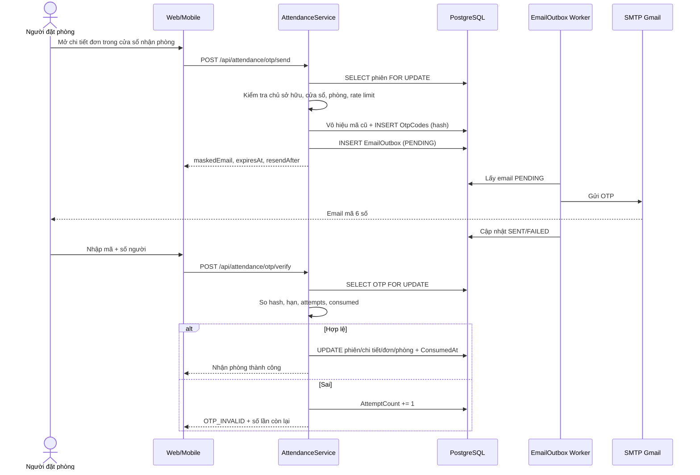
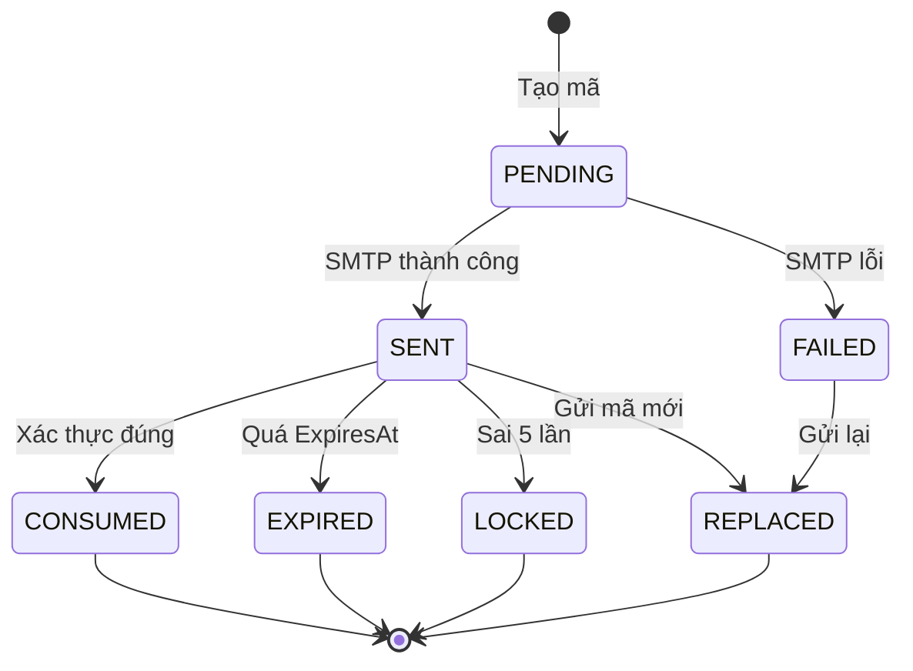

# 06 — Thiết kế điểm danh bằng OTP Gmail (thay QR code)

> Đề cương yêu cầu điểm danh bằng QR code. Nhóm thay bằng **OTP 6 số gửi tới Gmail của người đặt phòng**. Tài liệu này đặc tả mục tiêu, quy tắc, dữ liệu, API, giao diện, báo cáo và kiểm thử cho thay đổi đó.

## 1. Bối cảnh và phạm vi

### 1.1 Vấn đề cần giải

Quy trình hiện tại tạo `UsageSessions.ConfirmationCode` dạng `HUIT-xxxxx` ngay khi duyệt và gửi kèm email. Mã này:

- Không phải OTP: không hết hạn, không giới hạn số lần dùng, không gắn chặt với thời điểm nhận phòng.
- Được sinh bằng `Random`, không đủ mạnh để chống dò.
- Không có bản ghi kiểm tra, không đo được tỷ lệ điểm danh.

### 1.2 Mục tiêu

| Mã | Mục tiêu |
|---|---|
| G-01 | Xác thực người nhận phòng bằng mã dùng một lần gửi tới email người đặt |
| G-02 | Chỉ cho phép nhận phòng trong cửa sổ `[T−15 phút, T)` |
| G-03 | Ghi nhận đầy đủ ai nhận phòng, bằng phương thức nào, lúc nào |
| G-04 | Tổng hợp được tỷ lệ điểm danh, no-show, check-in hộ cho báo cáo |
| G-05 | Không chặn nghiệp vụ khi SMTP lỗi; nhân viên luôn có đường check-in hộ |

### 1.3 Ngoài phạm vi

- Điểm danh lớp học tín chỉ hoặc điểm danh bằng khuôn mặt/thẻ từ.
- Xác thực hai lớp cho đăng nhập (OTP ở đây chỉ dùng cho nhận phòng và quên mật khẩu).
- Gửi OTP qua SMS/Zalo.

## 2. Tác nhân và use case

| Tác nhân | Use case | Quyền |
|---|---|---|
| Sinh viên/Giảng viên | UC20 Gửi OTP, UC21 Xác thực OTP | Chỉ với đơn của mình |
| Nhân viên/Quản lý | UC22 Check-in hộ | Trong đơn vị quản lý |
| Admin | UC22 Check-in hộ toàn hệ thống | Toàn hệ thống |
| Hệ thống | UC20 gửi mã theo yêu cầu, UC23 hủy no-show | — |

## 3. Quy tắc nghiệp vụ OTP

| Mã | Quy tắc | Lý do |
|---|---|---|
| OTP-01 | Mã gồm 6 chữ số sinh bằng CSPRNG (`RandomNumberGenerator`), không dùng `Random` | Chống đoán |
| OTP-02 | Chỉ lưu `HMAC-SHA256(mã, pepper)` dạng hex; pepper lấy từ biến môi trường | Lộ DB không lộ mã |
| OTP-03 | Hạn = `min(SentAt + 10 phút, T)`; hết hạn phải gửi lại | Không dùng được sau giờ bắt đầu |
| OTP-04 | Mỗi mã dùng một lần; xác thực thành công đặt `ConsumedAt` | Chống phát lại |
| OTP-05 | Sai tối đa 5 lần; lần thứ 5 sai khóa mã, buộc gửi lại | Chống brute-force |
| OTP-06 | Gửi lại cách nhau ≥ 60 giây, tối đa 3 lần/chi tiết đặt phòng; mã cũ bị vô hiệu | Chống spam |
| OTP-07 | Mỗi chi tiết đặt phòng chỉ có tối đa một mã còn hiệu lực | Tránh nhiều mã song song |
| OTP-08 | Chỉ gửi tới `AspNetUsers.Email` của người đặt; không nhận email do client truyền | Chống chiếm quyền nhận phòng |
| OTP-09 | Chỉ gửi và xác thực trong `[T−15, T)` | Khớp BR-06 |
| OTP-10 | Mã gắn với `BookingId` + `BookingDetailId` + `UserId`; xác thực phải khớp cả ba | Chống dùng chéo |
| OTP-11 | Không log mã, không trả mã trong response, che email khi hiển thị | Bảo mật |
| OTP-12 | Nhân viên check-in hộ phải nhập lý do; ghi `STAFF_OVERRIDE` + người thực hiện | Truy vết |
| OTP-13 | Gửi email thất bại không chặn check-in hộ; trạng thái gửi hiển thị cho nhân viên | Vận hành |
| OTP-14 | So sánh hash bằng constant-time; xác thực trong transaction có khóa dòng | Chống race/timing |
| OTP-15 | Khi đơn bị hủy/no-show, mọi mã chưa dùng bị vô hiệu | Tránh dùng lại |

## 4. Mô hình đe dọa và biện pháp

| # | Đe dọa | Kịch bản | Biện pháp |
|---|---|---|---|
| R01 | Đoán mã | Thử 000000–999999 | 5 lần/mã, 60 giây/gửi, cửa sổ 15 phút, giới hạn theo người dùng |
| R02 | Lộ email | Người khác đọc được hộp thư | Cảnh báo qua thông báo khi check-in thành công; nhân viên đối chiếu thẻ |
| R03 | Chuyển tiếp email | Người đặt gửi mã cho bạn | Mã gắn tài khoản; hành vi vi phạm; đối chiếu ngẫu nhiên |
| R04 | Phát lại | Dùng lại mã đã nhập | `ConsumedAt`, mã dùng một lần |
| R05 | Dò tài khoản | Gửi OTP cho email không tồn tại | Phản hồi trung tính, không tiết lộ tài khoản |
| R06 | Spam email | Bấm gửi liên tục | 60 giây/lần, tối đa 3 lần |
| R07 | Lộ DB | Đọc bảng OTP | Chỉ có hash + pepper ngoài DB |
| R08 | Lạm dụng check-in hộ | Nhân viên nhận phòng khống | Bắt buộc lý do, ghi audit, báo cáo số lần override |
| R09 | Race condition | Vừa xác thực vừa no-show | Khóa dòng + cập nhật có điều kiện; no-show bỏ qua nếu đã check-in |
| R10 | Đổi email sau khi đặt | Người dùng đổi email để nhận mã | Email chụp tại thời điểm gửi; đối chiếu `UserId` |

**Giới hạn cần nêu trong báo cáo**: OTP xác thực quyền kiểm soát hộp thư, không xác thực sự hiện diện vật lý. Vì vậy hệ thống vẫn giữ bước nhân viên đối chiếu ngẫu nhiên và ghi nhận số người thực tế khi nhận phòng.

## 5. Luồng xử lý

### 5.1 Gửi và xác thực OTP



### 5.2 Trạng thái mã OTP



Mã `EXPIRED`/`LOCKED`/`REPLACED` vẫn giữ bản ghi để đối soát; không xóa cứng.

### 5.3 Tương tác với no-show

- No-show chỉ hủy khi `UsageSessions.Status = 'Chờ nhận phòng'` **và** `Bookings.CheckedInAt IS NULL` **và** `now ≥ T`.
- Khi check-in thành công, cập nhật `Bookings.CheckedInAt` trong cùng transaction để watcher không hủy.
- Watcher chạy mỗi 30 giây, dùng cập nhật có điều kiện; nếu 0 dòng bị ảnh hưởng nghĩa là đã check-in hoặc đã xử lý.
- Khi hủy no-show: vô hiệu OTP chưa dùng, tạo thông báo, gửi email (qua outbox).

## 6. Thiết kế dữ liệu

Bảng `OtpCodes` (chi tiết ở [05-thiet-ke-csdl.md §3.5](05-thiet-ke-csdl.md#otpcodes--bổ-sung)):

| Cột | Vai trò trong luồng OTP |
|---|---|
| `Purpose` | `ROOM_CHECK_IN` cho điểm danh; `PASSWORD_RESET` dùng lại cho quên mật khẩu |
| `UserId`, `Email` | Người nhận, chụp tại thời điểm gửi |
| `BookingId`, `BookingDetailId` | Phạm vi mã |
| `CodeHash` | HMAC-SHA256 + pepper |
| `SentAt`, `ExpiresAt` | Thời hạn |
| `AttemptCount`, `ResentCount` | Chống brute-force/spam |
| `ConsumedAt` | Dùng một lần |
| `DeliveryStatus` | Theo dõi SMTP |

**Ràng buộc “một mã còn hiệu lực”**: PostgreSQL không cho dùng `now()` trong predicate của partial index (hàm không immutable), nên dùng cột `IsActive`. DDL và index chốt nằm ở [05 §5.3](05-thiet-ke-csdl.md#53-ddl-bảng-bổ-sung):

```sql
CREATE UNIQUE INDEX "UQ_OtpCodes_Active"
ON "OtpCodes" ("BookingDetailId", "Purpose")
WHERE "IsActive" = true AND "IsDeleted" = false;
```

Service đặt `IsActive = false` khi mã bị thay thế, bị khóa hoặc khi đơn bị hủy.

**Lưu trữ**: giữ OTP 90 ngày để đối soát; job dọn đánh dấu `IsDeleted = true` cho bản ghi hết hạn (không xóa cứng, theo DB-03).

## 7. Tích hợp hệ thống

| Thành phần | Thay đổi |
|---|---|
| `BookingService` duyệt đơn | Ngừng gửi `ConfirmationCode` như mã điểm danh; email chỉ thông báo kết quả và hướng dẫn nhận phòng |
| `UsageService.CheckInAsync` | Giữ cho nhân viên; thêm nhánh xác thực OTP cho người dùng |
| `BookingNoShowService` | Vô hiệu OTP khi hủy; không hủy nếu đã check-in |
| `EmailService` | Thêm mẫu `CHECKIN_OTP`; chuyển sang gửi qua outbox |
| `BookingReminderService` | Nhắc trước T−30 phút kèm hướng dẫn nhận phòng |
| Notification | Thêm loại `OTP_SENT`, `CHECKIN_SUCCESS`, `NO_SHOW` |
| Audit | Ghi `CHECK_IN_OTP`, `CHECK_IN_OVERRIDE`, `OTP_SEND` |

**Tương thích ngược**: giữ cột `UsageSessions.ConfirmationCode` và endpoint `GET /api/UsageSessions/code/{code}` cho nhân viên trong giai đoạn chuyển đổi; người dùng thường không còn dùng mã này.

## 8. Thiết kế API

### 8.1 Gửi OTP

```http
POST /api/attendance/otp/send
Authorization: Bearer <jwt>
Content-Type: application/json

{ "bookingDetailId": 123 }
```

```json
{
  "success": true,
  "message": "Mã xác nhận đã gửi tới n***@huit.edu.vn.",
  "data": {
    "maskedEmail": "n***@huit.edu.vn",
    "expiresAt": "2026-11-05T09:10:00Z",
    "resendAfterSeconds": 60,
    "remainingResends": 2
  }
}
```

### 8.2 Xác thực OTP

```http
POST /api/attendance/otp/verify
Authorization: Bearer <jwt>

{ "bookingDetailId": 123, "code": "482913", "actualGuestCount": 8 }
```

```json
{
  "success": true,
  "message": "Đã nhận phòng A101 lúc 09:05.",
  "data": { "usageSessionId": 55, "status": "Đang sử dụng", "actualCheckIn": "2026-11-05T09:05:00Z" }
}
```

### 8.3 Check-in hộ

```http
POST /api/attendance/check-in-override
Authorization: Bearer <jwt>   // Employee/Manager/Admin

{ "bookingDetailId": 123, "actualGuestCount": 8, "reason": "Sinh viên không truy cập được email" }
```

### 8.4 Trạng thái nhận phòng

```http
GET /api/attendance/{bookingDetailId}/status
```

```json
{
  "success": true,
  "data": {
    "window": "Open",
    "opensAt": "2026-11-05T08:45:00Z",
    "startsAt": "2026-11-05T09:00:00Z",
    "otp": { "sentAt": "2026-11-05T08:50:00Z", "expiresAt": "2026-11-05T09:00:00Z", "remainingAttempts": 4 },
    "session": { "status": "Chờ nhận phòng" }
  }
}
```

### 8.5 Mã lỗi

| HTTP | Mã | Thông điệp |
|---|---|---|
| 400 | `OTP_WINDOW_NOT_OPEN` | “Chưa đến giờ nhận phòng.” |
| 400 | `OTP_WINDOW_EXPIRED` | “Đã hết giờ nhận phòng.” |
| 400 | `OTP_INVALID` | “Mã xác nhận không đúng. Còn {n} lần thử.” |
| 400 | `OTP_EXPIRED` | “Mã đã hết hạn. Vui lòng gửi lại.” |
| 400 | `OTP_ATTEMPTS_EXCEEDED` | “Mã đã bị khóa. Vui lòng gửi lại mã mới.” |
| 400 | `OTP_CONSUMED` | “Mã đã được sử dụng.” |
| 429 | `OTP_RATE_LIMITED` | “Vui lòng gửi lại sau {n} giây.” |
| 403 | `NOT_SESSION_OWNER` | “Bạn chỉ có thể nhận phòng cho đơn của mình.” |
| 409 | `ROOM_MAINTENANCE` | “Phòng đang bảo trì.” |
| 409 | `CAPACITY_EXCEEDED` | “Số người vượt sức chứa.” |
| 409 | `BOOKING_CANCELLED` | “Đơn đã bị hủy.” |

Không trả khác biệt giữa “email không tồn tại” và “tài khoản không có email” để tránh dò tìm.

## 9. Thiết kế giao diện

### 9.1 Web — trang chi tiết đơn

| Trạng thái cửa sổ | Hiển thị |
|---|---|
| Trước T−15 | Nút “Gửi mã điểm danh” bị vô hiệu; nhãn “Mở lúc {giờ}” |
| Trong cửa sổ, chưa gửi | Nút chính “Gửi mã điểm danh” |
| Đã gửi | Ô nhập “Mã xác nhận”, nút “Nhận phòng”, dòng “Đã gửi tới {email che}” |
| Gửi lại | Liên kết “Gửi lại” + đếm ngược 60 giây |
| Sai mã | Dòng lỗi ngắn: “Mã không đúng. Còn 4 lần thử.” |
| Hết giờ | “Đã hết giờ nhận phòng.” (không còn nút) |

### 9.2 Mobile — thẻ “Nhận phòng”

- Hiển thị tên phòng, khung giờ, trạng thái.
- Nút “Gửi mã điểm danh” → màn hình nhập 6 số.
- Tự động gửi lại khi hết hạn nếu còn lượt.
- Thông báo thành công: “Đã nhận phòng A101 lúc 09:05.”

### 9.3 Nguyên tắc copy

- Chỉ hiển thị hành động và trạng thái; không thêm đoạn giải thích dài.
- Không hiển thị mã OTP trong bất kỳ màn hình nào.
- Email che dạng `abc***@huit.edu.vn`.

## 10. Báo cáo điểm danh

| Chỉ số | Công thức | Nguồn |
|---|---|---|
| Tỷ lệ điểm danh | `checked_in / approved_details` | `UsageSessions.ActualCheckIn`, `BookingDetails` |
| Tỷ lệ no-show | `no_show / approved_details` | `Bookings.CancelReason = 'NO_SHOW'` |
| Tỷ lệ check-in hộ | `override / checked_in` | `AuditLogs.Action = 'CHECK_IN_OVERRIDE'` |
| Thời gian nhận phòng trung bình | `avg(T - ActualCheckIn)` | `BookingDetails.StartAt`, `UsageSessions` |
| Số chi tiết có OTP gửi lỗi | `count(detail có DeliveryStatus='FAILED')` | `OtpCodes.DeliveryStatus` |
| Tỷ lệ gửi lại | `resent / issued` | `OtpCodes.ResentCount` |

```sql
SELECT date_trunc('week', d."StartAt") AS week,
       COUNT(*) AS approved_details,
       COUNT(*) FILTER (WHERE s."ActualCheckIn" IS NOT NULL) AS checked_in,
       COUNT(*) FILTER (WHERE b."CancelReason" = 'NO_SHOW') AS no_show,
       COUNT(*) FILTER (WHERE EXISTS (
           SELECT 1 FROM "OtpCodes" o
           WHERE o."BookingDetailId" = d."Id"
             AND o."Purpose" = 'ROOM_CHECK_IN'
             AND o."DeliveryStatus" = 'FAILED')) AS otp_failed,
       ROUND(AVG(EXTRACT(EPOCH FROM (d."StartAt" - s."ActualCheckIn")) / 60.0)::numeric, 1) AS avg_lead_minutes
FROM "BookingDetails" d
JOIN "Bookings" b ON b."Id" = d."BookingId"
LEFT JOIN "UsageSessions" s ON s."BookingDetailId" = d."Id" AND s."IsDeleted" = false
WHERE d."IsDeleted" = false
  AND d."Status" IN ('Đã duyệt','Đang sử dụng','Hoàn thành')
  AND d."StartAt" >= $1 AND d."StartAt" < $2
GROUP BY week
ORDER BY week;
```

## 11. Kiểm thử

| # | Loại | Kịch bản | Kỳ vọng |
|---|---|---|---|
| T01 | Unit | Sinh mã 6 số | Luôn gồm 6 chữ số, phân bố không trùng lặp liên tiếp |
| T02 | Unit | Hash + verify đúng | Trả true; sai trả false |
| T03 | Unit | Hết hạn tại T | Không xác thực được sau T |
| T04 | Integration | Gửi OTP trước T−15 | `OTP_WINDOW_NOT_OPEN` |
| T05 | Integration | Gửi OTP trong cửa sổ | Tạo bản ghi, email outbox PENDING |
| T06 | Integration | Gửi lại sau 30 giây | `OTP_RATE_LIMITED` |
| T07 | Integration | Gửi lại sau 60 giây | Mã cũ `IsActive = false`, mã mới tạo |
| T08 | Integration | Sai 5 lần | Lần 5 khóa mã; lần 6 `OTP_ATTEMPTS_EXCEEDED` |
| T09 | Integration | Xác thực đúng | Phiên Đang sử dụng, phòng Đang sử dụng, `CheckedInAt` có giá trị |
| T10 | Integration | Xác thực lại mã đã dùng | `OTP_CONSUMED` |
| T11 | Integration | Người khác dùng mã | `NOT_SESSION_OWNER` |
| T12 | Integration | Dùng mã của chi tiết khác | `OTP_INVALID` |
| T13 | Integration | Số người vượt sức chứa | `CAPACITY_EXCEEDED` |
| T14 | Integration | Phòng bảo trì | `ROOM_MAINTENANCE` |
| T15 | Integration | No-show chạy đồng thời với check-in | Một bên thắng, không có trạng thái mâu thuẫn |
| T16 | Integration | Hủy đơn khi có OTP chưa dùng | OTP bị vô hiệu, không dùng được |
| T17 | Integration | SMTP lỗi | Outbox FAILED, check-in hộ vẫn hoạt động |
| T18 | Security | Brute-force 100 lần | Bị chặn sau 5 lần, có rate limit |
| T19 | Security | Response không chứa mã | Không tìm thấy OTP trong JSON/log |
| T20 | Security | SQL injection vào `code` | Tham số hóa, không lỗi |
| T21 | E2E | Sinh viên nhận phòng trên web | Luồng đầy đủ trong cửa sổ |
| T22 | E2E | Sinh viên nhận phòng trên mobile | Luồng đầy đủ |
| T23 | E2E | Nhân viên check-in hộ | Ghi audit + lý do, phiên chuyển Đang sử dụng |
| T24 | Báo cáo | Truy vấn tỷ lệ điểm danh | Khớp dữ liệu kiểm thử |

## 12. Triển khai và chuyển đổi

| Bước | Việc cần làm | Điều kiện hoàn thành |
|---|---|---|
| 1 | Thêm bảng `OtpCodes`, `EmailOutbox`, cột `IsActive` | Migration chạy được trên DB sạch và DB hiện có |
| 2 | Cấu hình `OtpSettings` (pepper, TTL, số lần) qua biến môi trường | Không có pepper trong repo |
| 3 | Cài `AttendanceService`, outbox worker | Unit + integration test đạt |
| 4 | Thêm API và phân quyền | Swagger hiển thị; 403 đúng vai trò |
| 5 | Web: trang chi tiết đơn | Luồng E2E đạt |
| 6 | Mobile: thẻ nhận phòng | Luồng E2E đạt |
| 7 | Chuyển email duyệt: bỏ mã tĩnh, thêm hướng dẫn nhận phòng | Không còn email chứa mã tĩnh cho người dùng |
| 8 | Bật theo dõi báo cáo điểm danh | Số liệu khớp thủ công trên dữ liệu seed |

**Cấu hình đề xuất**

```json
{
  "OtpSettings": {
    "Pepper": "<từ biến môi trường OTP_PEPPER>",
    "RoomCheckInTtlMinutes": 10,
    "PasswordResetTtlMinutes": 10,
    "MaxAttempts": 5,
    "ResendCooldownSeconds": 60,
    "MaxResends": 3,
    "AutoSendOnWindowOpen": false
  }
}
```

## 13. Giới hạn và hướng phát triển

| Giới hạn | Hướng khắc phục |
|---|---|
| OTP không chứng minh hiện diện vật lý | Bổ sung ảnh check-in, quét thẻ, hoặc QR động tại phòng trong phiên bản sau |
| Phụ thuộc hộp thư cá nhân | Cho phép cấu hình email phụ đã xác thực |
| Không có push notification | Bổ sung Firebase Cloud Messaging cho mobile |
| Chưa có refresh token | Bổ sung để thu hồi phiên khi tài khoản bị khóa |
| Một instance API | Nếu scale ngang, cần Redis backplane cho SignalR và khóa phân tán cho job |

## 14. Truy vết tài liệu

| Nội dung | Tài liệu |
|---|---|
| Quy tắc nghiệp vụ nền | [01 §7](01-khao-sat-hien-trang.md#7-quy-tắc-nghiệp-vụ) |
| Use case UC20–UC23 | [03](03-dac-ta-use-case.md) |
| Kiến trúc module và triển khai | [04](04-kien-truc-he-thong.md) |
| Bảng, khóa, chỉ mục | [05](05-thiet-ke-csdl.md) |
